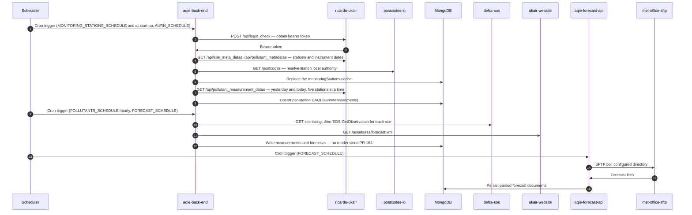

<!-- GENERATED FILE — DO NOT EDIT.
     Source: /docs/integration-catalog.yaml
     Regenerate: python3 scripts/generate_diagrams.py -->

# Scheduled air quality data ingestion

_Generated 2026-11-19T20:10:05Z from `/docs/integration-catalog.yaml`._

How measurement and forecast data enters the estate. Runs on cron schedules, not on user request. The UK-AIR sweep and the forecast feed in aqie-back-end are still written to MongoDB, but nothing has read them since the /measurements and /forecasts endpoints were removed.

