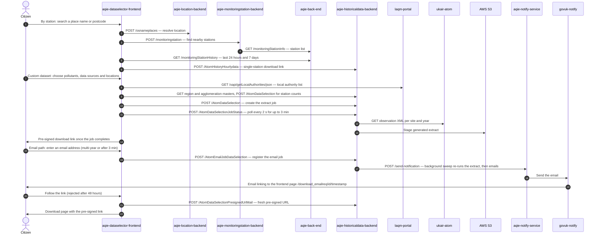

<!-- GENERATED FILE — DO NOT EDIT.
     Source: /docs/integration-catalog.yaml
     Regenerate: python3 scripts/generate_diagrams.py -->

# Citizen: download historic air quality data

_Generated 2026-11-19T20:10:05Z from `/docs/integration-catalog.yaml`._

Two journeys share one service: by station (search, recent-readings tabs and per-pollutant downloads) and custom dataset (filters, then an extract job). A single-year extract downloads directly once the job completes; multi-year requests, and any job still running after three minutes, are emailed.

