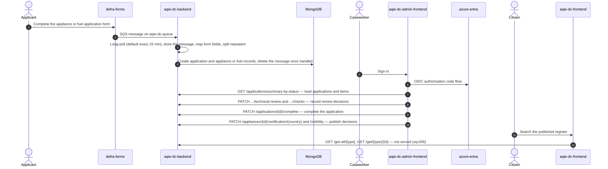

<!-- GENERATED FILE — DO NOT EDIT.
     Source: /docs/integration-catalog.yaml
     Regenerate: python3 scripts/generate_diagrams.py -->

# Smoke control: appliance and fuel applications

_Generated 2026-11-19T20:10:05Z from `/docs/integration-catalog.yaml`._

Applications arrive asynchronously from DEFRA Forms over SQS, not through the AQIE frontend. The admin frontend is the caseworker review and certification interface and requires sign-in on every route. The public frontend calls routes the backend does not serve, so the public register may currently be broken (oq-006). The CDP Uploader import flow in the backend no longer completes, because its callback has been removed (oq-025).

