<!-- GENERATED FILE — DO NOT EDIT.
     Source: /docs/integration-catalog.yaml
     Regenerate: python3 scripts/generate_diagrams.py -->

# AQIE Service-to-Service Dependencies

_Generated 2026-11-19T20:10:05Z from `/docs/integration-catalog.yaml`._

Internal AQIE edges only. External systems are excluded to keep the ownership boundary clear — see the system context diagram for those.

```mermaid
graph TD
  aqie_alert_back_end_service["alert-back-end-service"]
  aqie_back_end["back-end"]
  aqie_dataselector_frontend["dataselector-frontend"]
  aqie_dc_admin_frontend["dc-admin-frontend"]
  aqie_dc_backend["dc-backend"]
  aqie_dc_frontend["dc-frontend"]
  aqie_docanalysisawspoc_frontend["docanalysisawspoc-frontend"]
  aqie_docanalysispoc_backend["docanalysispoc-backend"]
  aqie_docanalysispoc_frontend["docanalysispoc-frontend"]
  aqie_forecast_api["forecast-api"]
  aqie_front_end["front-end"]
  aqie_historicaldata_backend["historicaldata-backend"]
  aqie_location_backend["location-backend"]
  aqie_maps_frontend["maps-frontend"]
  aqie_maps_prototype["maps-prototype"]
  aqie_monitoringstation_backend["monitoringstation-backend"]
  aqie_notify_service["notify-service"]
  aqie_prtr_backend["prtr-backend"]
  aqie_prtr_frontend["prtr-frontend"]
  defra_forms["defra-forms"]
    aqie_front_end -->|"GET /monitoringStationInfo"| aqie_back_end
    aqie_front_end -->|"GET /forecast"| aqie_forecast_api
    aqie_monitoringstation_backend -->|"GET /monitoringStationInfo?with-closed=true&with-pollutants=1&stream=data"| aqie_back_end
    aqie_monitoringstation_backend -->|"POST /osnameplaces"| aqie_location_backend
    aqie_dataselector_frontend -->|"GET /AtomDataSelectionPollutantMaster<br/>POST /AtomDataSelectionPollutantDataSource<br/>GET /AtomDataSelectionRegionMaster<br/>GET /AtomDataSelectionAgglomerationMaster<br/>+6 more"| aqie_historicaldata_backend
    aqie_dataselector_frontend -->|"POST /osnameplaces"| aqie_location_backend
    aqie_dataselector_frontend -->|"POST /monitoringstation<br/>GET /monitoringstation/by-location"| aqie_monitoringstation_backend
    aqie_dataselector_frontend -->|"GET /monitoringStationHistory"| aqie_back_end
    aqie_dataselector_frontend -.->|"GET /map<br/>POST /map/view"| aqie_maps_frontend
    aqie_maps_frontend -.->|"POST /station-summary"| aqie_dataselector_frontend
    aqie_alert_back_end_service -.->|"GET /notify/unsubscribe-email-link"| aqie_front_end
    aqie_notify_service -->|"DELETE /opt-out-sms-alert"| aqie_alert_back_end_service
    aqie_dc_frontend -->|"GET /get-all/{type}<br/>GET /get/{type}/{id}"| aqie_dc_backend
    defra_forms -.->|"AWS SQS"| aqie_dc_backend
    aqie_dc_admin_frontend -->|"GET /applications/counts<br/>GET /applications/summary-by-status?type={type}<br/>GET /applications/{id}/summary?type={type}<br/>GET /applications/{id}<br/>+17 more"| aqie_dc_backend
    aqie_prtr_frontend -->|"GET /facilities/search<br/>GET /facilities/nearby<br/>GET /facilities/{id}/details<br/>GET /facilities/{id}/competent-authority<br/>+5 more"| aqie_prtr_backend
    aqie_prtr_backend -->|"POST /osnameplaces"| aqie_location_backend
    aqie_maps_frontend -->|"GET /monitoringStations<br/>GET /aurnData<br/>GET /monitoringStationInfo"| aqie_back_end
    aqie_maps_frontend -->|"GET /forecast"| aqie_forecast_api
    aqie_docanalysisawspoc_frontend -->|"HTTPS/REST"| aqie_docanalysispoc_backend
    aqie_docanalysispoc_frontend -->|"HTTPS/REST"| aqie_docanalysispoc_backend
    aqie_front_end -->|"POST /setup-alert<br/>DELETE /opt-out-email-alert<br/>GET /aqsr-alert<br/>GET /daqi-alert<br/>+1 more"| aqie_alert_back_end_service
    aqie_front_end -->|"POST /subscribe/generate-otp<br/>POST /subscribe/validate-otp<br/>POST /subscribe/generate-link<br/>GET /subscribe/validate-link/{token}"| aqie_notify_service
    aqie_alert_back_end_service -->|"POST /send-notification"| aqie_notify_service
    aqie_alert_back_end_service ==>|"GET /forecast"| aqie_forecast_api
    aqie_notify_service -.->|"GET /notify/register/email-confirm-link"| aqie_front_end
    aqie_maps_prototype -->|"GET /monitoringStations<br/>GET /monitoringStationInfo<br/>GET /health"| aqie_back_end
    aqie_maps_prototype -->|"GET /forecast"| aqie_forecast_api
    aqie_historicaldata_backend -.->|"POST /send-notification"| aqie_notify_service
```

## Edge detail

| Source | Target | Interaction | Endpoints | Data exchanged | Confidence |
|---|---|---|---|---|---|
| `aqie-alert-back-end-service` | `aqie-forecast-api` | scheduled-batch | `GET /forecast` | Forecast DAQI values with station coordinates | `confirmed` |
| `aqie-alert-back-end-service` | `aqie-front-end` | user-redirect | `GET /notify/unsubscribe-email-link` | Email address carried as a plain query parameter | `confirmed` |
| `aqie-alert-back-end-service` | `aqie-notify-service` | synchronous | `POST /send-notification` | Recipient, Notify template id, personalisation and alertId out; notification id back | `confirmed` |
| `aqie-dataselector-frontend` | `aqie-back-end` | synchronous | `GET /monitoringStationHistory` | siteId (Ricardo AURN form) and period (24h or 7d) as query parameters in; hourly readings and summary figures out | `confirmed` |
| `aqie-dataselector-frontend` | `aqie-historicaldata-backend` | synchronous | `GET /AtomDataSelectionPollutantMaster` `POST /AtomDataSelectionPollutantDataSource` `GET /AtomDataSelectionRegionMaster` `GET /AtomDataSelectionAgglomerationMaster` `POST /AtomDataSelection` `POST /AtomDataSelectionJobStatus` `POST /AtomEmailJobDataSelection` `POST /AtomDataSelectionPresignedUrlMail` `POST /AtomHistoryHourlydata` `POST /AtomHistoryexceedence` | Master list of selectable pollutants Selected pollutant in; data source categories and networks out Zone (region) list for the custom dataset location picker Agglomeration list for the custom dataset location picker Selection criteria in; extract job reference out. Also used with count parameters for the live station count Job reference in; job status and result URL out Selection criteria and email address in; the text Success out. The backend sends the email later Job reference taken from the emailed link in; pre-signed download URL out Station, pollutant, year and frequency in; download URL for that series out Station and year in; exceedence table out | `confirmed` |
| `aqie-dataselector-frontend` | `aqie-location-backend` | synchronous | `POST /osnameplaces` | Place-name query in; OS Names gazetteer matches out | `confirmed` |
| `aqie-dataselector-frontend` | `aqie-maps-frontend` | user-redirect | `GET /map` `POST /map/view` | Hub page Search on a map link, and the station page Back link when the station was opened from the map Form fields lat, lng and siteId for the station being viewed, so the map centres on it | `confirmed` |
| `aqie-dataselector-frontend` | `aqie-monitoringstation-backend` | synchronous | `POST /monitoringstation` `GET /monitoringstation/by-location` | { userLocation, usermiles } in; nearby stations with pollutants out lat, lng and name query parameters in; one matching station out (404 when none) | `confirmed` |
| `aqie-dc-admin-frontend` | `aqie-dc-backend` | synchronous | `GET /applications/counts` `GET /applications/summary-by-status?type={type}` `GET /applications/{id}/summary?type={type}` `GET /applications/{id}` `GET /appliances/{id}` `GET /appliances/{id}/technical-review` `GET /fuels/{id}/technical-review` `GET /appliance-types?isPrimary={isPrimary}` `GET /admin/appliances/search` `GET /admin/appliances/{id}` `GET /api/admin/appliances/{id}/action-history` `PATCH /applications/{id}/in-progress` `PATCH /applications/{id}/complete` `PATCH /appliances/{id}` `PATCH /appliances/{id}/technical-review` `PATCH /appliances/{id}/technical-review/checks` `PATCH /appliances/{id}/certification/{country}` `PATCH /appliances/{id}/visibility` `PATCH /fuels/{id}` `PATCH /fuels/{id}/technical-review` `PATCH /fuels/{id}/technical-review/checks` | Case counts by status for appliances and fuels Incomplete applications grouped by status with item names (type is appliance or fuel) Items in one application with technical review status (type is appliance or fuel) One application; optional groupBy=techReviewStatus splits items into accepted and rejected Full appliance record Appliance review state and outstanding checks Fuel review state, supplier type and outstanding checks Appliance type picklists (isPrimary is true or false) Keyword, status filter and page in; appliance register page out Admin view of one appliance: certification by country, status, legacy comments, instruction manual, test reports One page of appliance action history, newest first Reviewer name and email out; application marked in progress Reviewer name and email out; application completed (409 if items outstanding) Edited appliance fields (type, model name, model number, nominal output, variant, multifuel) Accept or reject decision plus reviewer identity (409 if checks outstanding) One check result and, for some checks, the confirmed data Certified or uncertified for one UK country plus the deciding user Show or hide on the public list plus the acting user Edited fuel fields (brand names, original fuel details, description, manufacturing process, quality control) Accept or reject decision plus reviewer identity One check result (manufacturer letter, test results, fuel details, fuel description) | `confirmed` |
| `aqie-dc-frontend` | `aqie-dc-backend` | synchronous | `GET /get-all/{type}` `GET /get/{type}/{id}` | Register type in; full record set out Single register record | `confirmed` |
| `aqie-docanalysisawspoc-frontend` | `aqie-docanalysispoc-backend` | synchronous | — | — | `confirmed` |
| `aqie-docanalysispoc-frontend` | `aqie-docanalysispoc-backend` | synchronous | — | — | `confirmed` |
| `aqie-front-end` | `aqie-alert-back-end-service` | synchronous | `POST /setup-alert` `DELETE /opt-out-email-alert` `GET /aqsr-alert` `GET /daqi-alert` `GET /api/subscriptions/{contact}` | Verified phone number or email address, location, coordinates, channel and language (SMS and email journeys) Email address; removes the subscription Air quality summary report breaches by date range, or for a coordinate on the current day DAQI alert content for coordinates on the current day SMS journey only: subscription count for a phone number. No matching route exists on the alert backend (oq-015); the check fails open. | `confirmed` |
| `aqie-front-end` | `aqie-back-end` | synchronous | `GET /monitoringStationInfo` | Searched coordinates, distance and station-count limits in; live per-station pollutant concentrations, station metadata and coordinates out | `confirmed` |
| `aqie-front-end` | `aqie-forecast-api` | synchronous | `GET /forecast` | Forecast DAQI values by day and region, plus the forecast-summary narrative | `confirmed` |
| `aqie-front-end` | `aqie-notify-service` | synchronous | `POST /subscribe/generate-otp` `POST /subscribe/validate-otp` `POST /subscribe/generate-link` `GET /subscribe/validate-link/{token}` | Mobile number in; one-time code dispatched Mobile number and code in; verification result out Email address, location and coordinates in; magic link dispatched Link token in; pending subscription payload out | `confirmed` |
| `aqie-historicaldata-backend` | `aqie-notify-service` | asynchronous | `POST /send-notification` | Recipient email address, Notify template identifier, and a download link as personalisation | `confirmed` |
| `aqie-maps-frontend` | `aqie-back-end` | synchronous | `GET /monitoringStations` `GET /aurnData` `GET /monitoringStationInfo` | Full station list for map plotting and the station list panel Observed DAQI index per AURN station. Only localSiteID and daqiIndex are read; they colour the markers and fill the panel DAQI row. A station absent from the response is still plotted, grey and unnumbered Per-station detail. Reached only through the proxy route GET /api/monitoring-station-info, which nothing in this repository calls | `confirmed` |
| `aqie-maps-frontend` | `aqie-dataselector-frontend` | user-redirect | `POST /station-summary` | Form fields lat, lng and name for the selected station; the dataselector looks the station up and redirects to /stationdetails | `confirmed` |
| `aqie-maps-frontend` | `aqie-forecast-api` | synchronous | `GET /forecast` | Forecast DAQI values by day and location | `confirmed` |
| `aqie-maps-prototype` | `aqie-back-end` | synchronous | `GET /monitoringStations` `GET /monitoringStationInfo` `GET /health` | Station list for plotting Selected station detail Upstream availability probe | `confirmed` |
| `aqie-maps-prototype` | `aqie-forecast-api` | synchronous | `GET /forecast` | Forecast DAQI values | `confirmed` |
| `aqie-monitoringstation-backend` | `aqie-back-end` | synchronous | `GET /monitoringStationInfo?with-closed=true&with-pollutants=1&stream=data` | Full station metadata including closed sites and pollutant coverage | `confirmed` |
| `aqie-monitoringstation-backend` | `aqie-location-backend` | synchronous | `POST /osnameplaces` | Location query (JSON body userLocation) in; gazetteer matches out | `confirmed` |
| `aqie-notify-service` | `aqie-alert-back-end-service` | synchronous | `DELETE /opt-out-sms-alert` | { phoneNumber } in; opt-out confirmation out | `confirmed` |
| `aqie-notify-service` | `aqie-front-end` | user-redirect | `GET /notify/register/email-confirm-link` | Verification token carried as a query parameter | `confirmed` |
| `aqie-prtr-backend` | `aqie-location-backend` | synchronous | `POST /osnameplaces` | { userLocation } in; Ordnance Survey Names matches out | `confirmed` |
| `aqie-prtr-frontend` | `aqie-prtr-backend` | synchronous | `GET /facilities/search` `GET /facilities/nearby` `GET /facilities/{id}/details` `GET /facilities/{id}/competent-authority` `GET /facilities/{id}/record/{year?}` `GET /facilities/{id}/record/{year}/lines/{lineId}` `GET /locations/search` `GET /reports` `GET /reports/get-download-link/{year}` | Search criteria in; matching facilities out Coordinates in; nearby facilities out Full facility detail record Regulating authority for the facility Facility release record; year optional, defaults to latest Individual release or transfer line detail Location search backing the facility finder Available annual dataset reports Year in; pre-signed S3 download link out | `confirmed` |
| `defra-forms` | `aqie-dc-backend` | asynchronous | — | meta.formSlug, meta.referenceNumber, meta.timestamp and data.main plus repeater blocks. Routed on formSlug 'get-a-solid-fuel-certified-for-use-in-smoke-control-areas' (fuel); any other slug is treated as an appliance application. | `confirmed` |
