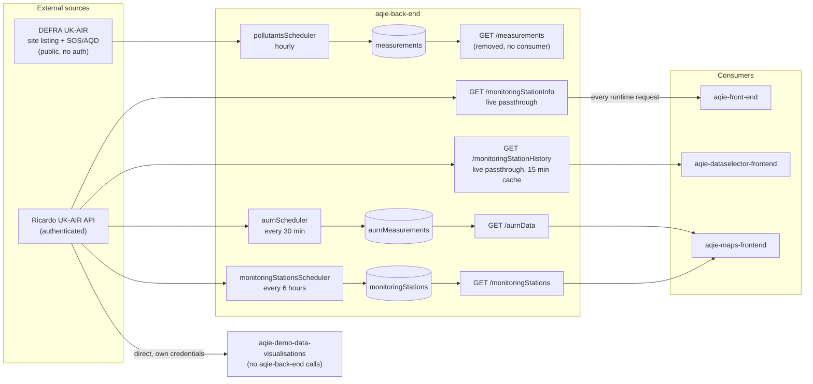
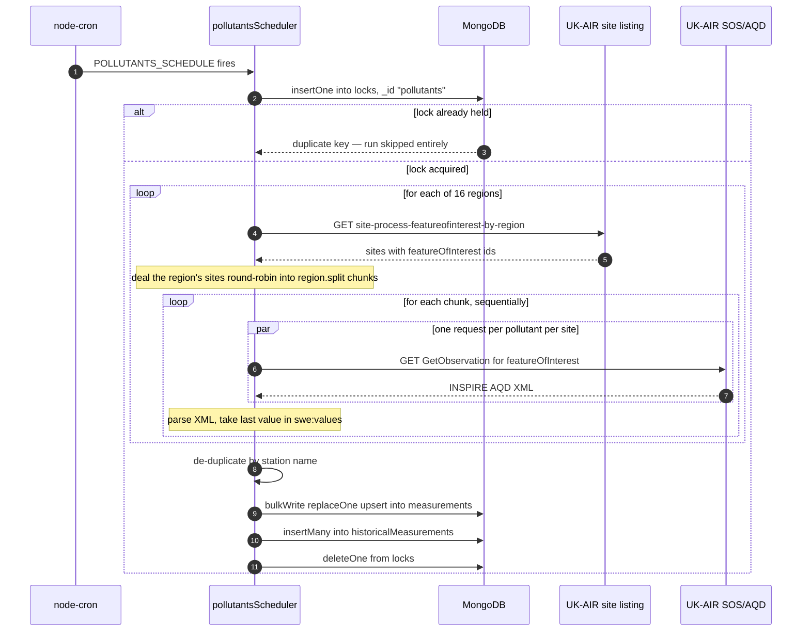

# Measurements Data Flow — the decommissioned `/measurements` path

> ## Status: the `/measurements` endpoint has been removed
>
> `GET /measurements` and `GET /forecasts` were removed from `aqie-back-end` by
> [PR #163](https://github.com/DEFRA/aqie-back-end/pull/163) (merged 2026-09-23), after CDP
> logs confirmed no production traffic on either across the log retention window.
>
> **The current serving path is `GET /monitoringStationInfo`.** For how the live citizen
> journey works today, see
> [`monitoring-station-info-data-flow.md`](monitoring-station-info-data-flow.md).
>
> **This document is retained deliberately**, for three reasons:
>
> 1. **The ingest pipelines described here still run.** The PR removed the read endpoints
>    only. `pollutantsScheduler` and `forecastScheduler` are still registered in
>    `src/api/server.js` and still write to MongoDB: the pollutants job hourly, the forecast
>    job hourly between 05:00 and 10:00 and once at start-up. The `measurements` and
>    `forecasts` collections are therefore still being rewritten, and the
>    `historicalMeasurements` and `historicalForecasts` collections still grow, **with no
>    reader**. That is live behaviour, not history.
> 2. **It records the UK-AIR SOS pipeline**, which remains the only documented route to the
>    feature-of-interest mapping and to non-Ricardo observation data. The pipeline still runs
>    but has **no primary consumer**: the last one, `aqie-demo-data-visualisations`, stopped
>    calling `aqie-back-end` in its own PR #15 (merged 2026-10-07).
> 3. **It documents the DAQI banding defects** in `aqie-front-end`, which are unaffected by
>    the endpoint removal and still citizen-facing.
>
> Read the serving and consumption stages below as a record of what was removed. Read the
> source, ingest, storage and DAQI stages as current.
>
> **Verified against `main`.** The statements in this document were re-verified on
> 2026-11-19 against `main`: `aqie-back-end` at `77a030c3` (2026-11-16), which includes the
> merge of PR #163, and the consumers `aqie-front-end` at `210c0c03`,
> `aqie-demo-data-visualisations` at `7f8d8f53` and `aqie-maps-frontend` at `13a9eb7f`.

How a pollutant reading travelled from a roadside analyser to a number on
check-air-quality.service.gov.uk under the `/measurements` path, and every repository, job,
collection and endpoint it passed through on the way.

This document exists to support diagramming and presentation. Each stage is written so it
can become one slide. See [Suggested slide structure](#suggested-slide-structure) at the end.

> **Provenance.** Every claim below is traced to source in the cloned repositories. See
> [Evidence and provenance](#evidence-and-provenance) for the exact commits analysed.
> Statements not confirmed in code are marked **(to confirm)**.

## Contents

- [The headline](#the-headline)
- [Two parallel measurement pipelines](#two-parallel-measurement-pipelines)
- [Stage 1 — Source systems](#stage-1--source-systems)
- [Stage 2 — Ingest into aqie-back-end](#stage-2--ingest-into-aqie-back-end)
- [Stage 3 — Storage](#stage-3--storage)
- [Stage 4 — Serving (removed)](#stage-4--serving-removed)
- [Stage 5 — Consumption (removed)](#stage-5--consumption-removed)
- [Stage 6 — Rendering to the citizen](#stage-6--rendering-to-the-citizen)
- [The supporting pipelines](#the-supporting-pipelines)
- [Data model reference](#data-model-reference)
- [DAQI is calculated in three different places](#daqi-is-calculated-in-three-different-places)
- [Timing and freshness](#timing-and-freshness)
- [Failure modes](#failure-modes)
- [Suggested slide structure](#suggested-slide-structure)
- [Open questions](#open-questions)
- [Evidence and provenance](#evidence-and-provenance)

## The headline

Five things are worth stating before anything else, because they contradict assumptions
that are easy to make — including assumptions recorded elsewhere in this documentation set.

**1. `/measurements` is not fed by the Ricardo API.** Earlier documentation, including the
service profile for `aqie-back-end`, stated that measurements are ingested from the Ricardo
UK-AIR API. That is not what the code does. The `measurements` collection that backed
`GET /measurements` is populated exclusively from two **public, unauthenticated DEFRA UK-AIR
endpoints** — a per-region site listing and the UK-AIR SOS/AQD observation service. The
authenticated Ricardo API feeds different collections entirely. The service profile now
reflects this.

**2. There are two independent measurement pipelines that do not talk to each other.**
The UK-AIR SOS pipeline fills `measurements` and served `/measurements`. The Ricardo AURN
pipeline fills `aurnMeasurements` and serves `/aurnData`. They fetch different data, from
different providers, on different schedules, with different averaging rules, and they can
legitimately disagree about the same station. **Both still run.** Removing the read endpoint
did not remove the pipeline behind it.

**3. `/measurements` has been removed, but its ingest has not.**
[PR #163](https://github.com/DEFRA/aqie-back-end/pull/163) deleted the route plugin,
controller and read helper. `pollutantsScheduler` remains registered in `src/api/server.js`
and still rewrites the `measurements` collection every hour and appends to
`historicalMeasurements`. The same is true of `forecastScheduler`, the `forecasts` collection
and `historicalForecasts` (hourly from 05:00 to 10:00, and once at start-up). **Nothing reads
any of the four**, and no consumer of `/measurements` is left: `aqie-demo-data-visualisations`,
the last, now reads the Ricardo API directly, and the old call site in `aqie-front-end` cannot
be reached at runtime (see [stage 5](#stage-5--consumption-removed)). The SOS pipeline
therefore has no primary consumer. `measurements` and `forecasts` are replaced in place and
stay small; it is the two `historical*` collections that **grow continuously** — storage cost,
plus upstream request load on public UK-AIR endpoints, for data nobody can retrieve.

**4. The Ricardo URL defaults in code point at the supplier's staging environment, but
production overrides them.** The citizen journey now runs exclusively through the Ricardo-fed
`/monitoringStationInfo`, so which Ricardo host `aqie-back-end` calls matters. The committed
defaults in `src/config/index.js` for all four Ricardo URLs are the staging host
`uk-air-api.staging.rcdo.co.uk`. Production does not rely on them. All four variables are set
in the service-wide defaults, none is overridden per environment, and none points at the
staging host, per CDP environment configuration. The defaults remain a hazard. See
[the finding below](#finding-ricardo-staging-defaults-in-code-overridden-in-production).

**5. The front-end feature flag is vestigial, not a rollback path.**
`USE_NEW_RICARDO_MEASUREMENTS_ENABLED` is `true` in every environment,
per CDP environment configuration, but it no longer decides which endpoint the citizen
journey calls. Every runtime request already goes to `/monitoringStationInfo`: the English
controller hard-codes the new source, the shared fetch forces it for any argument that is not
a boolean, and only the Welsh controller reads the flag, to choose the response parser. The
legacy `MEASUREMENTS_API_URL` branch cannot be reached at runtime, so setting the flag to
`false` does **not** call the removed endpoint. At worst the Welsh page would parse the
response as the wrong shape and fail (read from the code, not run; see 5a). The flag, the
variable and the dead branch are still in source at `210c0c03` and should be deleted. See
[Residual breakage after removal](#residual-breakage-after-removal).



## Two parallel measurement pipelines

| | **SOS pipeline** | **AURN pipeline** |
|---|---|---|
| Upstream | `uk-air.defra.gov.uk` (public) | Ricardo, authenticated (the code default is the staging host `uk-air-api.staging.rcdo.co.uk`; the URL variables are set in the service-wide defaults and none points at it, per CDP environment configuration) |
| Protocol | REST JSON + SOS/AQD XML | REST JSON, OAuth bearer |
| Scheduler | `pollutantsScheduler` | `aurnScheduler` |
| Cadence | `0 */1 * * *` — hourly; no run at start-up | `*/30 * * * *` — every 30 minutes; no run at start-up |
| Mongo lock | `pollutants` | `aurnMeasurements` |
| Collection written | `measurements` (+ `historicalMeasurements`) | `aurnMeasurements` |
| Upsert key | `name` (station name) | `localSiteID` |
| Averaging | none — latest single observation | NO₂ latest hourly mean, SO₂ latest 15-minute mean, O₃ 8-hour mean, PM 24-hour mean; each needs at least 75% data capture |
| DAQI stored? | No | Yes, `daqiIndex` 1–10 |
| Served by | `GET /measurements` — **removed** | `GET /aurnData` |
| Primary consumer | **None now.** `aqie-demo-data-visualisations` moved to Ricardo directly (its PR #15), and `aqie-front-end` cannot reach the old path | `aqie-maps-frontend`, the only consumer |

The rest of this document follows the **SOS pipeline**, because that is the one that backs
`/measurements`. The AURN pipeline is covered in
[The supporting pipelines](#the-supporting-pipelines).

## Stage 1 — Source systems

Everything originates with physical monitoring equipment operated under DEFRA's national
networks. AQIE never touches the analysers. It reads two public DEFRA UK-AIR web services.

**1a. Regional site and feature-of-interest listing**

```text
GET https://uk-air.defra.gov.uk/data/API/site-process-featureofinterest-by-region
      ?group_id=4&closed=false&region_id={regionId}
```

No authentication. Returns, for one region, an array of sites. Each site carries
`site_name`, `local_site_id`, `location_type`, `latitude`, `longitude`, and a
`parameter_ids` array. Each entry in `parameter_ids` maps a pollutant code to a
**feature-of-interest identifier** — the handle used to ask the observation service for
actual readings.

The region list is hardcoded in the repository, not discovered. Sixteen regions:

North East Scotland, North Wales, Highland, Central Scotland, Eastern, South East,
South Wales, NorthWest And Merseyside, South West, East Midlands, Scottish Borders,
North East, Greater London, West Midlands, Yorkshire And Humberside, Isle of Man.

Only eight pollutant codes are retained: `O3`, `NO2`, `GE10`, `GR10`, `PM10`, `PM25`,
`GR25`, `SO2`. Anything else the API returns is discarded.

**1b. The SOS/AQD observation service**

```text
GET https://uk-air.defra.gov.uk/sos-ukair/service
      ?service=AQD&version=1.0.0&request=GetObservation
      &temporalFilter=om:phenomenonTime,{start}/{end}
      &featureOfInterest={featureOfInterestId}
```

No authentication. One request **per pollutant, per site**. Returns INSPIRE Air Quality XML
containing `om:OM_Observation` members with an `swe:DataArray` of comma-separated readings.

This is the same family of public endpoint that `aqie-historicaldata-backend` uses for
archive extracts, but a different service — SOS `GetObservation` here, Atom download there.

## Stage 2 — Ingest into aqie-back-end

Triggered by `node-cron` on `POLLUTANTS_SCHEDULE`, default `0 */1 * * *` — on the hour,
every hour. There is no run at start-up, so a freshly deployed container waits for the next
hour.



### Step by step

**2.1 — Distributed lock.** Before any work, the scheduler inserts a document with
`_id: 'pollutants'` into a `locks` collection. Because `_id` is unique, a second container
attempting the same insert fails and that container **silently skips the entire run**. The
lock is released in a `finally` block.

The `locks` collection has a time-to-live index of one hour on the document's `timestamp`,
created at start-up in `src/helpers/mongodb.js`. If a container is killed mid-run, its lock
therefore clears within about an hour (MongoDB checks for expired documents once a minute),
and until then **every run on every container is skipped**. For the hourly pollutants job that
is roughly one missed run; for the 30-minute AURN job, two. The exposure is bounded, but still
not monitored **(to confirm — whether any operational alerting covers skipped runs)**.

**2.2 — Region sweep.** Regions are processed **sequentially**, in the hardcoded order
above. There is no parallelism across regions.

**2.3 — Chunking.** Within a region, sites are split into `region.split` chunks — a
per-region constant ranging from 2 (North Wales) to 19 (South East, NorthWest And
Merseyside). Chunks are processed sequentially; within a chunk, all SOS requests are issued
in parallel. The split values appear to be empirically tuned to avoid overwhelming the SOS
service **(to confirm — the origin and rationale of these numbers)**.

**2.4 — Temporal window.** The `temporalFilter` window is built as:

- start: now (UTC) **minus 2 days**, set to 23:00:00
- end: now (UTC) plus 2 days plus 1 year, set to 00:00:00

The end bound is over a year in the future. The effect is a very wide window from which only
the **last** reading is taken, which makes the query tolerant of publication lag but also
means a stale reading will be accepted without complaint if nothing newer exists.

**2.5 — XML parsing.** `fast-xml-parser` parses the response. The reading is extracted from
the second `gml:featureMember`, navigating to
`om:OM_Observation → om:result → swe:DataArray → swe:values`, splitting on commas and
taking the **last** element as the value. The timestamp is taken as the **fourth-from-last**
element of the same array.

This is positional parsing against a fixed structural assumption. A change in the shape of
the SOS response would produce wrong values rather than an error **(to confirm — whether
this has ever caused an incident)**.

**2.6 — Value normalisation.**

| Input | Stored value |
|---|---|
| Empty, non-numeric or `NaN` (including the `N/A` and `N/M` markers in step 2.7) | `null` |
| Between 0 and 1, above 0.98999 | rounded to integer (so `1`) |
| Between 0 and 1, at or below 0.98999 | fixed to 2 decimal places |
| 1 or above | rounded to nearest integer |
| Zero or negative, including instrument codes such as `-9999` | rounded to nearest integer, so stored as the code itself |

Concentrations are therefore stored as whole µg/m³ for all realistic values.

**2.7 — Exception handling per reading.** Two sentinel states are recorded in the
`exception` field rather than being treated as errors. In both, `value` is stored as `null`
(the marker is not numeric, so step 2.6 discards it) and `time.date` is `null`:

| Condition | `value` | `exception` |
|---|---|---|
| Site has no usable feature-of-interest id | `null` | `"N/A"` |
| SOS returned an `ows:ExceptionReport`, or the response is a reporting header rather than an observation | `null` | `"N/M"` |

`N/M` means "not measured". A reading with a real value has an empty `exception`. Anything
reading these documents must check `exception`, because `value` alone cannot tell "not
measured" from "no usable site id".

**2.8 — Freshness check.** Each timestamp is compared against now. If the reading is more
than **65 minutes** old, an error is logged (`STALE DATA DETECTED`) naming the station and
pollutant. **The record is still written.** Staleness is observable in logs only; nothing is
flagged on the data, and no consumer can tell a fresh reading from a stale one.

**2.9 — Timezone.** The reading time is parsed with `moment` and passed through a
`Europe/London` conversion before storage, but MongoDB stores dates as UTC instants, so the
conversion does not change what is stored. The hour, day, month and year strings that the front
end now displays are produced by `/monitoringStationInfo`, not by this pipeline.

**2.10 — De-duplication.** Before writing, the flattened result is de-duplicated by station
`name`, keeping the first occurrence. A station appearing in two regions is therefore
recorded once, under whichever region was swept first.

## Stage 3 — Storage

MongoDB, database from `MONGO_DATABASE`. Indexes on `name` and a `2dsphere` index on
`location` are created at start-up for `measurements`, `historicalMeasurements`, `forecasts`,
`historicalForecasts` and `monitoringStations` (`src/helpers/mongodb.js`).

**`measurements`** — current state, one document per station.

Written as a bulk `replaceOne` with `upsert: true`, keyed on station **name**. The whole
document is replaced each run — there is no merge, so a pollutant that disappears from the
upstream listing disappears from the document. The collection stays the size of the station
list.

Note the key. `measurements` is keyed on `name`; `aurnMeasurements` is keyed on
`localSiteID`. Joining the two collections requires going through the `localSiteID` field
that `measurements` happens to also carry.

**`historicalMeasurements`** — append-only archive.

Every station document from every hourly run is inserted unchanged with `insertMany`, after
the `measurements` write (an error in the `measurements` write is logged and the insert still
runs). This collection grows without bound. It has the `name` and `location` indexes above but
no TTL, and no retention policy is defined in the repository. At roughly the number of stations
swept per hour, this accumulates continuously **(to confirm — current collection size, whether
any out-of-band pruning exists, and whether anything reads it)**.

**`locks`** — one document per in-flight scheduled job, described in step 2.1.

## Stage 4 — Serving (removed)

> **Removed by [PR #163](https://github.com/DEFRA/aqie-back-end/pull/163).** The route
> plugin, controller and read helper were all deleted. The ingest that filled the collection
> was not. Described here as a record of what the endpoint did.

`GET /measurements` on `aqie-back-end`. Registered as a Hapi plugin named `measurements`.

The handler was deliberately thin: one unfiltered `find` over the `measurements` collection,
with the internal `_id` projected out, returned as an array.

Characteristics worth stating plainly on a slide:

- **No query parameters.** No filtering by location, pollutant, or time.
- **No pagination, no limit, no sort.** Every station document, every call.
- **No caching.** Every request is a full collection scan returned over the wire.
- **No authentication.** CDP internal network only.
- Sets `Access-Control-Allow-Origin` from `ACCESS_CONTROL_ALLOW_ORIGIN_URL`.

Callers wanting "stations near me" must fetch the whole national dataset and filter
client-side. `aqie-front-end` did exactly that on the legacy path, which it can no longer
reach at runtime — see stage 5.

Response envelope:

```json
{
  "message": "success",
  "measurements": [ /* array of station documents */ ]
}
```

## Stage 5 — Consumption (removed)

> **Record of the consumers that existed before removal.** CDP logs showed no production
> traffic on `/measurements` across the retention window, which is what justified the
> removal. One repository still contains a call site, as dead code: `aqie-front-end` (5a).
> `aqie-demo-data-visualisations` removed its own call in 2026-10 (5d). See the
> [residual breakage](#residual-breakage-after-removal) note at the end of this section.

### 5a. aqie-front-end — no runtime path uses /measurements

`aqie-front-end` still carries two configured URLs and a flag that looks as if it chooses
between them. All three are in source at `210c0c03` (`src/config/index.js`: flag at lines
172–177, URLs at 409–420). Both committed defaults are internal CDP addresses of the form
`https://<service>.<env>.cdp-int.defra.cloud` followed by the endpoint path. The last column
gives variable names and set or true states only.

| Config key | Env var | Committed default | Setting in deployed environments |
|---|---|---|---|
| `measurementsApiUrl` | `MEASUREMENTS_API_URL` | The `aqie-back-end` `/measurements` path | Set in every environment, per CDP environment configuration. Read only by the legacy branch, which no runtime caller can reach |
| `ricardoMeasurementsApiUrl` | `NEW_RICARDO_MEASUREMENTS_API_URL` | The `aqie-back-end` `/monitoringStationInfo?` path | Set in every environment, per CDP environment configuration. Used for every runtime request |
| `useNewRicardoMeasurementsEnabled` | `USE_NEW_RICARDO_MEASUREMENTS_ENABLED` | `true` | `true` in every environment, per CDP environment configuration (set explicitly, not left to the code default) |

**Every runtime request goes to `/monitoringStationInfo`, whatever the flag says.**

- **English pages.** The location controller passes a hard-coded `true`
  (`src/server/location-id/controller.js:96` and `:171`), so the flag has no effect.
- **The shared fetch.** `fetchMeasurements` forces the new source for any argument that is not
  a boolean (`src/server/locations/helpers/fetch-data.js:152–171`). Both runtime callers pass
  an object, never a boolean (`src/server/locations/helpers/get-nearest-location.js:266` and
  `:283`).
- **Welsh pages.** The Welsh controller reads the flag
  (`src/server/location-id/cy/controller.js:371–373`) and passes it on, but the flag only
  chooses the response parser (`get-nearest-location.js:305–322`). The request still goes to
  `/monitoringStationInfo`. With the flag at `false`, that response object would be handed to
  the legacy parser, which expects an array. By reading the code, the `filter` call at
  `get-nearest-location.js:163` would throw, and the Welsh handler turns an exception into a
  generic error response. The likely result is a failed Welsh location page, not a request to
  the removed endpoint **(read from the code, not run; to confirm)**.
- **The dead branch.** `MEASUREMENTS_API_URL` is read only by `buildOldMeasurementsSelection`
  (`src/server/locations/helpers/extracted/api-utils.js:371–380`), which is chosen at `:404–410`
  only when the flag argument is a literal boolean `false`. Only tests pass one.
  `extracted/fetch-data-core-helpers.js` is an unused duplicate of that logic: no non-test
  file imports it.

The new-source request carries a server-side query, built in `buildMeasurementsQueryParams`
(`extracted/api-utils.js:239–256`): page 1, the latest measurement only, closed stations
excluded, pollutant data included, the searched latitude and longitude to six decimal places,
network 4, at most three stations (`totalItems=3`), `distance=60` and a `daqi-pollutant` flag.
The back end forwards only an allow-list of these to Ricardo and uses `totalItems` itself
(`aqie-back-end` `src/api/locationsite/helpers/fetch-ricardo-data-all.js:15–24`), so
`latest-measurement` and `daqi-pollutant` have no effect there, and `/monitoringStationInfo`
returns no DAQI.

This is a material architectural difference. On the live path the **back end** asks Ricardo
for the stations near the searched point and cuts the list to three. On the legacy path the
**front end** downloaded every station in the country and filtered locally.

The two branches do not share a parser, so the flag could never be flipped without changing
downstream code. The live branch reads the `measurements` property of the response object
(`fetchNewNearestLocationsRange`), while the legacy branch hands the whole response to the
station selection as if it were an array (`fetchLegacyNearestLocationsRange`;
`get-nearest-location.js:260–322`). Whether the legacy branch ever worked against the old
`/measurements` response was not checked. More importantly, the flag no longer changes the
URL (`fetch-data.js:152–171`), and English pages ignore it.

`/monitoringStationInfo` is a **live passthrough to the Ricardo API on every citizen
request**, not a read from MongoDB. It obtains an OAuth token (cached in the Hapi `yar`
session), queries Ricardo `site_meta_datas`, then enriches each station with pollutant
measurement data from Ricardo `pollutant_measurement_datas`.

The consequence is significant for the presentation: **a citizen page load depends on
Ricardo being available in real time.** The scheduled-ingest insulation that the SOS
pipeline provided does not apply.

Failure behaviour is quiet. When the call returns anything other than HTTP 200, the shared
helper logs an error and returns an empty array (`extracted/api-utils.js:425–439`). The page
renders with no monitoring stations rather than an error.

### 5b. Nearest-station selection (written for `/measurements`, still runs on the live path)

Implemented in `buildNearestLocationsRange` (`get-nearest-location.js:143–180`) using the
`geolib` library. It was written for the legacy path, where the front end held every station
in the country. Both branches call it, so it also runs on the live `/monitoringStationInfo`
path (`:297–302`), where the back end has already cut the list to three stations.

1. `geolib.orderByDistance` sorts all station coordinates by distance from the searched
   point.
2. The nearest **3** are taken (`NEARBY_LOCATIONS_COUNT`).
3. Those 3 are filtered by `geolib.isPointWithinRadius` with a radius of **100,000 metres**
   — 100 km. Given the density of the UK network this radius almost never excludes anything,
   so in practice the rule is simply "nearest three".
4. Distance is recomputed with `geolib.getDistance`, converted to miles by
   `× 0.000621371192`, and rounded to **1 decimal place** for display.
5. Results are re-sorted ascending by distance.

There is a latent coordinate-ordering hazard here. The back end stores GeoJSON
`location.coordinates` as `[latitude, longitude]` (and `/monitoringStationInfo` emits the same
order), which is the **reverse** of the GeoJSON specification's `[longitude, latitude]`. The
front end reads `coordinates[0]` as latitude and `coordinates[1]` as longitude, so the two
agree and distances are correct — but any consumer that trusts the GeoJSON spec will compute
nonsense.
This should be called out as a known structural issue **(to confirm — whether any consumer
has been bitten by this)**.

### 5c. Pollutant filtering and banding in the front end

For each station, each pollutant is processed in `buildPollutantsObject`
(`get-nearest-location.js:70–107`). On the live path the same check and banding are applied
first, in `buildUpdatedPollutantsForMeasurement` (`:182–204`).

- The value is checked by `isValidNonNegativeNumber` (`:62–69`). It is coerced with
  `Number()` and kept only if the result is finite and zero or above. Non-numeric strings,
  `NaN`, infinities and negative values are dropped, including negative instrument codes such
  as `-9999`.
- **`null` is not dropped.** `Number(null)` is 0, so a null value passes, although the comment
  beside the check says null is rejected. The `N/A` and `N/M` markers are held in the
  `exception` field, not in `value`, and nothing in the front end filters on `exception`. The
  retired `/measurements` path stored `value` as `null` for those states (step 2.7). By
  reading the code, a not-measured reading from that path would therefore have passed the
  check and been banded as Low (index 1) instead of being dropped **(read from the code, not
  run; to confirm)**. The live path is not exposed to this, because `/monitoringStationInfo`
  already removes null, zero and the `-9999` and `-99` markers before it responds.
- If a station ends up with **no** valid pollutants, the whole station is dropped and an
  error is logged.
- Surviving values are passed to `getPollutantLevel`, which returns a DAQI number and a band
  label. Welsh uses `getPollutantLevelCy`, which shares the same thresholds via
  `pollutant-threshold-config.js` and differs only in label text. The response carries no
  DAQI, so the band always comes from this table.

Timestamps are passed through untouched. The code comment says the back end is the single
source of truth for the displayed hour, day, month and year, so the front end does no
adjustment or re-parsing (`get-nearest-location.js:84–98`).

### 5d. aqie-demo-data-visualisations — was the last /measurements consumer, no longer

Until 2026-10-07 this prototype called `GET /measurements` and read `data.measurements`. It
used the endpoint specifically because each station record carried the **`featureOfInterest`
identifier per pollutant** — the handle needed to query the UK-AIR SOS service directly for a
time series.

**It no longer calls `aqie-back-end` at all.** Its own PR #15 (merged 2026-10-07) deleted the
`/measurements` client (`app/lib/aqie-api.js`) and the SOS client (`app/lib/sos-history.js`).
At `7f8d8f53` no file under `app/` refers to `aqie-back-end`, `AQIE_BACK_END_URL` or
`/measurements`. The demo now logs in to the Ricardo UK-AIR API with its own credentials
(`RICARDO_API_EMAIL` and `RICARDO_API_PASSWORD`) and reads the station list and the hourly
readings from it directly (`app/lib/ricardo-api.js`). It was not migrated to
`/monitoringStationInfo`, so it needs no feature-of-interest mapping and nothing has to
replace it. Catalogue `oq-018` is answered, and `oq-039` asks whose Ricardo account the demo
uses. See [`/docs/integration-catalog.yaml`](../integration-catalog.yaml).

### 5e. aqie-maps-frontend — does not call /measurements

Confirmed by full-text search of the repository at `13a9eb7f`, tests included: no
`/measurements` path appears. The map's only use of `aqie-back-end` data is `/aurnData`, which
colours the markers, and `/monitoringStations`, which supplies the station list. Both go
through `src/server/common/helpers/aqie-back-end.js`. The same helper can also call
`/monitoringStationInfo`, but only through an unused proxy route, `GET /api/monitoring-station-info`:
nothing in the shipped interface calls it (security finding 50).

From each `/aurnData` item the map reads only `localSiteID` and `daqiIndex`
(`src/client/javascripts/map-station-data.js:182–196`). It never reads `measuredAt` or
`updatedAt`, which matters for the stale-index case in the [failure modes](#failure-modes).

### Residual breakage after removal

CDP logs showed no production traffic, so nothing in production broke. Source-level call
sites and configuration nonetheless remain in several repositories, and each is a trap for
whoever next touches them.

| Repository | What remains | Consequence |
|---|---|---|
| `aqie-front-end` | `MEASUREMENTS_API_URL`, the `USE_NEW_RICARDO_MEASUREMENTS_ENABLED` flag and the legacy branch that reads the old URL (`buildOldMeasurementsSelection`, `extracted/api-utils.js:371–380`), all still in source at `210c0c03`. The committed production and performance-test environment templates still list `MEASUREMENTS_API_URL` | **The old URL cannot be reached at runtime.** Setting the flag to `false` does not call the removed endpoint: English pages ignore the flag, and on Welsh pages it would select the wrong response parser, which would probably fail the page (read from the code, not run; see 5a). The flag is not a rollback path. It is dead code to delete (catalogue `oq-016`, answered, now low severity). |
| `aqie-demo-data-visualisations` | Nothing. Its PR #15 (merged 2026-10-07) removed the call | **Resolved.** The demo reads Ricardo directly, so no feature-of-interest mapping is needed (catalogue `oq-018`, answered). |
| `aqie-maps-frontend` | `GET /forecasts` fallback when `AQIE_FORECAST_API_URL` is unset (`src/server/common/helpers/aqie-forecast-api.js:12`) | The fallback would 404, but it is not reached in any deployed environment, per CDP environment configuration: `AQIE_FORECAST_API_URL` is set in every environment the service is deployed to. If it were reached, the browser would get a 500 from `/api/forecasts` and show an empty forecast list (read from the code, not run). Dead code to delete (catalogue `oq-017`). |
| `aqie-privatebeta-api-perftest` | JMeter plans for both endpoints | Will report failures; the plans never ran from the published image. |
| `aqie-publicbeta-test` | `MEASUREMENTS_API_URL` used to derive expected page values | Assertions sourcing expected values will fail. |
| `aqie-monitoringstation-backend` | Commented-out `/measurements` default beside the live `RICARDO_API_URL` default, which ends in `/monitoringStationInfo` (`src/config/index.js:149` and `:114–119`) | Could be reinstated by someone assuming it still works. The service stopped reading the old variable name on 2026-03-16 (commit `81ab5d4`); catalogue `oq-014` is answered. |
| `aqie-back-end` | `pollutantsScheduler` and `forecastScheduler` still registered and running | `measurements` and `forecasts` are rewritten with no reader, and `historicalMeasurements` and `historicalForecasts` grow without limit. |

The front-end row is still the one to raise first, but for a different reason from the one
this document gave earlier. The flag looks like a safety net and is not one, because it can
no longer restore the old behaviour, and the dead branch and variable are a trap for whoever
next reads that code.

## Stage 6 — Rendering to the citizen

The `location-id` controller assembles the page. Each of the three nearest stations is
rendered with its name, distance in miles, and a row per pollutant showing the
concentration in µg/m³, the band label, and the measurement time. English and Welsh
controllers are separate but share the threshold configuration.

## The supporting pipelines

### The AURN pipeline — `/aurnData`

Runs every 30 minutes (`AURN_SCHEDULE`, `*/30 * * * *`), lock name `aurnMeasurements`. There
is no run at start-up.

1. Read the stations with status `current` from the `monitoringStations` collection. If there
   are none, skip the run.
2. Authenticate: `POST /api/login_check` to Ricardo with email and password from config,
   receiving a bearer token.
3. For each station, `GET /api/pollutant_measurement_datas?station-id=&start-date-time=&end-date-time=&page=`
   with the window running from **yesterday 00:00:00 to today 23:59:00** — deliberately more
   than 24 hours so that 24-hour running means are always computable. Paginated, capped at
   10 pages per station; stations are processed five at a time.
4. Normalise pollutant names to codes. Upstream names contain HTML, for example
   `PM<sub>10</sub> particulate matter (Hourly measured)`, so the mapper strips `<sub>` tags
   and matches on substrings.
5. Apply the shared data-capture and averaging rules (`src/common/helpers/averaging.js`). Only
   rows that are exactly 60 minutes or 15 minutes long are used, and the `-9999` and `-99`
   no-reading markers count as gaps. An average exists only if at least **75%** of its inputs
   are valid: an hourly mean needs 3 of 4 fifteen-minute means, an 8-hour mean 6 of 8 hours,
   a 24-hour mean 18 of 24. There is no fallback to a partial window. Each pollutant is
   evaluated at its own newest valid reading: NO₂ the latest hourly mean, SO₂ the latest
   15-minute mean (omitted when Ricardo returns no 15-minute rows), O₃ the 8-hour mean, PM10
   and PM2.5 the 24-hour mean. A pollutant that fails its rule is left out, not estimated.
6. Calculate DAQI per pollutant from the official breakpoint table, then take the
   **maximum** across pollutants as the station's `daqiIndex`. Means are kept unrounded; the
   concentration is rounded to a whole number only immediately before the band comparison.
   A station with no calculable index is skipped.
7. `replaceOne` upsert into `aurnMeasurements`, keyed on `localSiteID`. A skipped station keeps
   its previous document, so `/aurnData` can serve an old index for it; only `updatedAt` shows
   how old, and the only consumer, `aqie-maps-frontend`, does not read it (`oq-030`).

Whether step 5 can work at all depends on Ricardo honouring the window sent in step 3.
Catalogue `oq-029` records that the `aqie-back-end` README says Ricardo ignores
`start-date-time` and `end-date-time` and falls back to the latest measurement. If that is
right, the 75% rule can never be met for PM2.5, PM10 and O₃, and the index silently leaves
them out. The history endpoint sends `start-date` and `end-date` instead. Unresolved.

The same rules produce the `summary` block of `GET /monitoringStationHistory`, which is a
live Ricardo read for one station rather than a scheduled job.

### The station metadata pipeline — `/monitoringStations`

Runs every 6 hours (`MONITORING_STATIONS_SCHEDULE`, `0 */6 * * *`) and also once at start-up,
after the server is listening. Fetches `GET /api/site_meta_datas?with-closed=true` from
Ricardo, derives station open and close dates and current pollutant coverage from
`GET /api/pollutant_metadatas`, and enriches each station with its owning local authority by
reverse-geocoding its coordinates, through the CDP egress proxy:

```text
GET https://api.postcodes.io/postcodes?lon={lon}&lat={lat}&radius=2000&wideSearch=true
```

taking `result[0].admin_district`. Five-second timeout; failures yield `null` and do not
block the batch. The scheduled run writes to `monitoringStations` with a `replaceOne` upsert
keyed on `name`. The start-up run takes no lock and replaces the whole collection if Ricardo
returns any stations.

## Data model reference

### `measurements` document — as it was returned by `GET /measurements`

```json
{
  "name": "London Marylebone Road",
  "area": "Greater London",
  "localSiteID": "MY1",
  "areaType": "Urban Traffic",
  "location": {
    "type": "Point",
    "coordinates": [51.52253, -0.154611]
  },
  "updated": "2026-09-22T10:00:00.000Z",
  "pollutants": {
    "NO2": {
      "featureOfInterest": "GB_SamplingPoint_...",
      "startDate": "1997-01-01",
      "endDate": null,
      "time": { "date": "2026-09-22T10:00:00.000Z" },
      "value": 42,
      "exception": ""
    },
    "PM25": {
      "featureOfInterest": "GB_SamplingPoint_...",
      "startDate": "2010-01-01",
      "endDate": null,
      "time": { "date": null },
      "value": null,
      "exception": "N/M"
    }
  }
}
```

Note: `coordinates` is `[lat, lon]`, not the GeoJSON-standard `[lon, lat]`.
`value` is a number or `null`; `exception` is empty, `"N/A"` or `"N/M"` (step 2.7).
`updated` is calculated once, when the process starts, and reused for every later run, so it
shows the container's start time rather than the time of the last sweep.

### `aurnMeasurements` document — as returned by `GET /aurnData`

```json
{
  "localSiteID": "MY1",
  "daqiIndex": 3,
  "measuredAt": "2026-09-22T09:00:00.000Z",
  "updatedAt": "2026-09-22T10:30:42.123Z",
  "pollutants": {
    "NO2": { "value": 42.7, "measuredAt": "2026-09-22T09:00:00.000Z" }
  }
}
```

`measuredAt` is the newest reading behind the index, as a UTC ISO string; `value` is the
unrounded concentration the index was banded from. A pollutant that failed its data-capture
rule has no entry.

### Field mapping across the flow

| UK-AIR listing | `measurements` | Front-end display |
|---|---|---|
| `site_name` | `name` | station heading, and `id` with spaces stripped |
| `local_site_id` | `localSiteID` | not displayed; the field that would join to `aurnMeasurements` |
| `location_type` | `areaType` | site type label |
| `latitude`, `longitude` | `location.coordinates[0]`, `[1]` | distance calculation |
| `parameter_ids[].parameter_id` | key in `pollutants` | pollutant row |
| `parameter_ids[].feature_of_interest[0].featureOfInterset` | `pollutants.*.featureOfInterest` | SOS time-series lookup key |
| last value in `swe:values` | `pollutants.*.value` | concentration in µg/m³ |
| 4th-from-last in `swe:values` | `pollutants.*.time.date` | measurement time |

Note the spelling `featureOfInterset` in the upstream payload. It is a typo in the DEFRA
API, faithfully consumed by `get-api-pollutants.js`.

## DAQI is calculated in three different places

This deserves a slide of its own.

| Where | Granularity | Basis |
|---|---|---|
| `aqie-back-end`, AURN pipeline | Full 1–10 index, stored as `daqiIndex` | Official DEFRA breakpoints, with the correct averaging period per pollutant and a 75% data-capture rule; banded on the rounded mean |
| `aqie-back-end`, `/monitoringStationHistory` | Full 1–10 index per pollutant and overall, calculated on each uncached request | The same shared module and breakpoints as the AURN pipeline, evaluated at each pollutant's newest reading in the window |
| `aqie-back-end`, SOS pipeline | Not calculated at all | — |
| `aqie-front-end` | Coarse 1 / 4 / 7 / 10 plus a band label | Own threshold table, applied to whatever value it received |
| `aqie-forecast-api` and `aqie-front-end`, forecast days | Full 1–10 index for today and the next four days, issued by `aqie-forecast-api`; the front end maps each index to a band and advice text and does not recalculate it | Index issued upstream, out of scope here. Band mapping: 1–3 Low, 4–6 Moderate, 7–9 High, 10 Very high (`src/server/data/en/air-quality.js:200–254`; Welsh `src/server/data/cy/air-quality.js:180–234`) |

For measured values the front end **always recalculates** and never uses a DAQI from
`aqie-back-end`: `/monitoringStationInfo` carries none, and the front end overwrites any
`daqi` or `band` it receives with its own (`get-nearest-location.js:182–204`). Forecast days
are different: the front end calculates nothing there, because the numeric index arrives from
`aqie-forecast-api`. The front end's measured-value thresholds are:

| Pollutant | Low ≤ | Moderate ≤ | High ≤ | Very High |
|---|---|---|---|---|
| PM10, GE10 | 50 | 75 | 100 | above 100 |
| PM2.5 | 36 | 53 | 70 | above 70 |
| NO₂ | 200 | 400 | 600 | above 600 |
| SO₂ | 266 | 710 | 1064 | above 1064 |
| O₃ | 100 | 160 | 240 | above 240 |

Compared against the official DEFRA band boundaries, PM10, NO₂ and O₃ match exactly.
Two do not:

- **PM2.5** — the official Low ceiling (index 3) is **35**, not 36. Because the lookup uses
  `value <= max`, a reading of exactly **36 µg/m³ is shown as Low** when DEFRA publishes it
  as index 4, **Moderate**. Off-by-one at a single boundary value.
- **SO₂** — the official Moderate ceiling (index 6) is **532**, not 710. Every reading from
  **533 to 710 µg/m³ is shown as Moderate** when DEFRA publishes it as index 7–9, **High**.
  710 is the ceiling of index 7, so the table appears to have taken the wrong row. This is a
  full band of under-reporting, not a boundary rounding artefact.

Both were verified on 2026-09-22 against the published DEFRA band tables at
[UK-AIR — What is the Daily Air Quality Index?](https://uk-air.defra.gov.uk/air-pollution/daqi?view=more-info)
("Boundaries Between Index Points for Each Pollutant"). The relevant published rows are:

| Pollutant | Index 3 ceiling (Low) | Index 6 ceiling (Moderate) | Index 9 ceiling (High) | Basis |
|---|---|---|---|---|
| PM2.5 | **35** | 53 | 70 | Daily mean historical; latest 24-hour running mean for current day |
| SO₂ | 266 | **532** | 1064 | 15-minute mean |
| PM10 | 50 | 75 | 100 | Daily mean historical; latest 24-hour running mean for current day |
| NO₂ | 200 | 400 | 600 | Hourly mean |
| O₃ | 100 | 160 | 240 | Running 8-hour mean |

Both affected paths are citizen-facing: `getPollutantLevel` is called from
`get-nearest-location.js` for both the English and Welsh location pages. **(To confirm —
whether the divergence is deliberate, and against which published DAQI revision the
front-end table was written.)**

A second, separate issue with this helper: it only ever returns index **1, 4, 7 or 10** —
the lowest index in each band. It cannot produce 2, 3, 5, 6, 8 or 9, so the per-pollutant
index shown to the citizen is coarser than DEFRA's 1–10 scale.

A further mismatch: the front end applies thresholds defined for specific averaging periods
(24-hour means for PM, 15-minute for SO₂, 8-hour for O₃) to values that, on the retired SOS
path, were **single latest observations with no averaging at all**. On the live path the
averaging depends on what Ricardo returns for each request (see
[`monitoring-station-info-data-flow.md`](monitoring-station-info-data-flow.md#stage-4--enrich-each-station-with-pollutants)),
so the band shown may still not be a DAQI band in the formal sense **(to confirm)**.

## Timing and freshness

| Job | Cron | Wall clock | Worst-case data age at the citizen |
|---|---|---|---|
| `pollutantsScheduler` | `0 */1 * * *` | on the hour; no run at start-up | no consumer now; before removal, up to 60 min of scheduler lag, plus upstream publication lag |
| `aurnScheduler` | `*/30 * * * *` | every 30 min; no run at start-up | up to 30 min plus averaging window; unbounded for a station that stops meeting the capture rule, because its old index is kept |
| `monitoringStationsScheduler` | `0 */6 * * *` | 00:00, 06:00, 12:00, 18:00, and once at start-up | up to 6 hours |
| `forecastScheduler` | `0 05-10 * * *` | hourly, 05:00–10:00 only, and once at start-up | — |

The only staleness signal in the SOS chain is the 65-minute log warning in step 2.8; nothing
is flagged on the stored data. The Ricardo-fed routes do return each reading's time, and
`/aurnData` also returns `updatedAt` for each station. But the only consumer of `/aurnData`,
`aqie-maps-frontend`, reads neither `updatedAt` nor `measuredAt`, so the citizen is shown no
age at all.

On the live front-end path there is no scheduler in the loop — the data is whatever Ricardo
returns at page-load time.

## Failure modes

Rows describing the SOS pipeline are read from the code, not run. With no consumer of
`/measurements` left, no citizen sees SOS-derived data now; for those rows the last column
shows what a consumer would have seen.

| Failure | Behaviour | Visible to citizen? |
|---|---|---|
| Lock left behind by a crashed container | That job's runs are skipped until the lock expires (one-hour expiry index) | Data freezes for up to about an hour |
| UK-AIR listing API unavailable (network error, or a response that is not a list) | The whole run aborts before anything is written; there is no per-region isolation | Stations keep their previous values until a later run succeeds |
| SOS request fails for one pollutant | A network-level failure aborts the whole run (the null response is dereferenced); an HTTP error status skips that reading and shifts the later readings in the chunk out of position | Previous values stay, or readings may be attributed to the wrong pollutant |
| SOS returns an exception report | Stored with `value` null and `exception` `"N/M"` | No consumer now. The front end's own check would have treated `null` as zero (see 5c) |
| Reading older than 65 minutes | Error logged, value stored anyway | No indication |
| Ricardo auth fails (AURN) | Exception logged, run abandoned, no retry | `/aurnData` serves previous values, and the map shows them as current |
| Station fails the data-capture rule (AURN) | Station skipped; its previous document stays | `/aurnData` serves an old index. The only consumer, `aqie-maps-frontend`, reads neither `updatedAt` nor `measuredAt`, so a citizen sees the old index as current, with no age marker (`oq-030`) |
| Ricardo unavailable (live front-end path) | `/monitoringStationInfo` returns an empty list with HTTP 200, or HTTP 500 if login itself fails; front end receives `[]` | Page renders with no stations |
| postcodes.io fails | `localAuthority` set to `null` | Missing local authority label |
| Station has no valid pollutants | Station dropped, error logged | Station simply absent |

There are **no retries anywhere** in the ingest path. A failed run waits for the next cron
tick.

## Suggested slide structure

This deck now tells a "what we removed and what it left behind" story. For the current
serving path, use the slide structure in
[`monitoring-station-info-data-flow.md`](monitoring-station-info-data-flow.md#suggested-slide-structure)
instead, or combine the two.

1. **Title** — The `/measurements` pipeline: what it was, and what remains
2. **The five headline findings** — from [The headline](#the-headline)
3. **System context** — the top-level Mermaid diagram, rendered in draw.io
4. **Two parallel pipelines** — the comparison table; both still run
5. **Stage 1: where the data comes from** — the two UK-AIR endpoints, 16 regions, 8 pollutants
6. **Stage 2: ingest** — the sequence diagram, with the lock called out
7. **Stage 2 detail: the awkward bits** — positional XML parsing, N/A and N/M sentinels, the 65-minute staleness log
8. **Stage 3: storage** — three collections, two different upsert keys, the unbounded archive
9. **Stage 4: what the endpoint did** — the thin handler, and what it did *not* do
10. **The removal** — PR #163, zero production traffic, read path deleted and ingest retained
11. **Orphaned pipelines** — four collections still written with no reader, two of them growing without limit; the SOS pipeline has no consumer left
12. **Residual breakage** — the table in [Residual breakage after removal](#residual-breakage-after-removal); lead with the dead front-end flag, which looks like a rollback path and is not one
13. **DAQI in three places** — the threshold comparison and the two verified divergences, plus the forecast-day mapping
14. **Freshness and failure** — the timing table and the failure table
15. **Open questions** — from the section below

For the diagrams, follow the conventions in
[`/docs/diagrams/drawio-guidelines.md`](../diagrams/drawio-guidelines.md) and the prompt
pattern in [`/draw-io-generation/prompts/`](../../draw-io-generation/prompts/README.md) so
the output matches the rest of the estate's visual language.

## Open questions

| # | Question | Why it matters |
|---|---|---|
| 1 | Should `pollutantsScheduler` and `forecastScheduler` be retired now the endpoints they fed are gone? | Four collections are written with no reader; two of them grow without limit. Storage cost plus continuous load on public UK-AIR endpoints for nothing. Catalogue `oq-019`, still open. |
| 2 | Which pipeline is authoritative when SOS and AURN disagree for the same station? | **Open** — to be raised with the wider team once the diagrams exist. Now largely a question about whether the SOS pipeline, which has no consumer, should be retired too. It remains the only documented route to the feature-of-interest mapping. |
| 3 | Is there a retention policy or pruning job for `historicalMeasurements` and `historicalForecasts`? | Insert-only, no TTL, grow on every run. |
| 4 | Does anything read `historicalMeasurements` or `historicalForecasts`? | If not, they are pure cost — now alongside `measurements` and `forecasts`. |
| 5 | Does anything alert when a run is skipped because its lock is held? | The lock expires after an hour, so a freeze is bounded, but it is silent. |
| 6 | Are the PM2.5 (36 vs 35) and SO₂ (710 vs 532) front-end thresholds deliberate? | Verified divergence from published DEFRA bands. Unaffected by the endpoint removal and still citizen-facing. |
| 7 | Where did the per-region `split` chunk counts come from? | They control upstream request pressure and nobody has documented the basis. |
| 8 | Has the `[lat, lon]` coordinate ordering caused a defect in any consumer? | Contradicts the GeoJSON spec the `type: "Point"` declaration implies. Present in `/monitoringStationInfo` too. |
| 9 | Should the `USE_NEW_RICARDO_MEASUREMENTS_ENABLED` flag, `MEASUREMENTS_API_URL` and the legacy branch be deleted from `aqie-front-end`? | **Yes, they can be (catalogue `oq-016`, answered 2026-11-19, now low severity).** The old URL cannot be reached at runtime, so the flag is vestigial rather than a broken rollback path. The dead code is still in source at `210c0c03`, so the deletion itself is outstanding. |
| 10 | What replaces the feature-of-interest mapping for `aqie-demo-data-visualisations`? | **Resolved (catalogue `oq-018`).** Nothing has to: the demo reads Ricardo directly since its PR #15 (merged 2026-10-07). See the answered table below. |
| 11 | Is the SOS pipeline's value assignment correct for sites that share a chunk? | Read from the code, not run: the response index restarts for every site in a chunk, so later sites appear to receive the first site's readings, and `updated` is fixed at process start. Confirm before anyone relies on `measurements`. |
| 12 | Should the Ricardo URL defaults in code be removed so that a missing variable fails fast? | They are the supplier's staging host. Production does not rely on them (see the finding below; catalogue `oq-012`, partly answered), but removing a variable would silently select staging. |
| 13 | Does Ricardo honour `start-date-time` and `end-date-time` on `pollutant_measurement_datas`? | Catalogue `oq-029`, open. If it ignores them, the 75% capture rule added in PR #165 can never be met for PM2.5, PM10 and O₃, and the map index silently leaves them out. |
| 14 | Is it intended that `/aurnData` keeps serving an old index for a station that stops meeting the capture rule? | Catalogue `oq-030`, open. The only consumer, `aqie-maps-frontend`, reads neither `updatedAt` nor `measuredAt`, so a citizen sees the old index as current. |

### Answered

| Question | Answer | Source |
|---|---|---|
| Is `USE_NEW_RICARDO_MEASUREMENTS_ENABLED` `true` in production? | **Yes.** Re-read on 2026-11-19: the flag is `true`, set explicitly, in every environment, per CDP environment configuration. The citizen journey uses `/monitoringStationInfo` for every runtime request, whatever the flag says (see 5a); `/measurements` is legacy. | CDP environment configuration, read 2026-09-22 and re-read 2026-11-19 |
| Are the front-end URL variables set in deployed environments? | **Yes.** `MEASUREMENTS_API_URL` and `NEW_RICARDO_MEASUREMENTS_API_URL` are both set in every environment, per CDP environment configuration (re-read 2026-11-19; the values were not read). Only `NEW_RICARDO_MEASUREMENTS_API_URL` is used at runtime; `MEASUREMENTS_API_URL` is read only by dead code. | CDP environment configuration, read 2026-11-19 |
| Is the Ricardo **staging** host overridden in production? | **Yes.** Re-checked 2026-11-19; this replaces the 2026-09-22 answer of "No". All four Ricardo URL variables are set in the service-wide defaults, none is overridden per environment, and none points at the staging host, per CDP environment configuration. See the finding below. | CDP environment configuration, read 2026-11-19 |
| Is `/measurements` being retired? | **Done.** Removed with `/forecasts` by [PR #163](https://github.com/DEFRA/aqie-back-end/pull/163). CDP logs confirmed zero production traffic on either across the retention window. Route plugins, controllers and read helpers deleted; **scheduled ingestion deliberately retained**. | PR #163, 2026-09-23 |
| What replaces the feature-of-interest mapping for `aqie-demo-data-visualisations`? | **Nothing has to.** The demo no longer calls `/measurements` or any `aqie-back-end` endpoint. It reads the Ricardo API directly, with its own credentials. | `aqie-demo-data-visualisations` PR #15, merged 2026-10-07; catalogue `oq-018` |

### Finding: Ricardo staging defaults in code, overridden in production

The committed defaults in `src/config/index.js` (lines 266–290) point all four Ricardo URLs —
`RICARDO_API_LOGIN_URL`, `RICARDO_API_ALL_DATA_URL`, `RICARDO_API_SITE_ID_URL` and
`RICARDO_API_POLLUTANT_METADATA_URL` — at **`https://uk-air-api.staging.rcdo.co.uk`**, the
supplier's staging environment. The repository's own `.env.example` (lines 4–7) documents the
production host `api-ukair.defra.gov.uk` instead, which is also the host
`aqie-alert-back-end-service` defaults to.

An earlier version of this document (2026-09-22) concluded that production was reading from
staging. That conclusion no longer holds. Re-checked on 2026-11-19, per CDP environment configuration:

- all four variables are set in the service-wide defaults, which apply to every environment
  unless overridden;
- none of the four is overridden in any environment's own file (dev, test, perf-test,
  ext-test, infra-dev, management and prod);
- none of the four is defined in the platform-wide global or per-environment defaults;
- none of the four points at the staging host, and each resolves to the host documented in
  `.env.example`.

So production does not rely on the staging defaults. Two limits remain. First, this is
configuration evidence, not observed traffic: CDP injects secrets last, and a secret of the
same name would override the configuration without showing up in the configuration
repository. That would be unusual for a non-sensitive URL, but it is not ruled out. Second, the
staging defaults in code are an unsafe fallback: if a variable were removed, the service would
call staging without any error. Making the four URLs required, with no default, would turn that
into a start-up failure. Catalogue `oq-012` is answered for this service on that basis.

### Completed: `/measurements` and `/forecasts` decommissioned

[PR #163](https://github.com/DEFRA/aqie-back-end/pull/163) (merge commit `d4a4554`, 2026-09-23)
removed both endpoints from `aqie-back-end`: 14 files changed, 254 lines deleted, no
additions. Route plugins, controllers, read helpers, their tests and the README rows were all
removed, along with the two imports and the two plugin registrations in `src/api/router.js`.
CDP logs showed zero production traffic on either endpoint across the log retention window
before removal.

The routes registered on `main` at 2026-11-19 are `health`, `metOfficeForecastRead`,
`metOfficeForecastList`, `monitoringStationInfo`, `monitoringStations`,
`monitoringStationHistory` (added later by PR #164, 2026-10-15) and `aurnData`.

Three things to carry forward:

1. **Scheduled ingestion was deliberately retained.** `pollutantsScheduler` and
   `forecastScheduler` are still registered in `src/api/server.js` (lines 81 and 83).
   `measurements` and `forecasts` are still rewritten (hourly, and hourly from 05:00 to 10:00
   plus once at start-up, respectively), `historicalMeasurements` and `historicalForecasts` still
   grow, and nothing reads any of the four. This is the largest piece of follow-up work the
   removal created. Retiring the pollutants job also means moving the shared constants in
   `src/api/pollutants/helpers/common/` first: 12 other modules import them.
2. **The replacement is not equivalent.** `/monitoringStationInfo` is fed by the **Ricardo**
   API, whereas `/measurements` was fed by the **UK-AIR SOS** pipeline — different
   providers, schedules and averaging. It also does **not** publish the feature-of-interest
   mapping. `aqie-demo-data-visualisations` was not migrated to it: its own PR #15 (merged
   2026-10-07) stopped it using `aqie-back-end` at all, and it now reads Ricardo directly.
3. **Source-level call sites and configuration survive in five repositories.** See
   [Residual breakage after removal](#residual-breakage-after-removal). None of them
   affected production. The `aqie-front-end` feature flag is vestigial: its legacy branch
   cannot be reached at runtime, so the flag cannot restore the old behaviour and setting it
   to `false` does not call the removed endpoint. The flag, the variable and the branch
   should be deleted.

The authoritative-pipeline question remains open and is now a question about whether the
SOS pipeline should be retired too, rather than about which endpoint to serve.

## Evidence and provenance

The first pass (2026-09-22) used local clones that were not on `main`. Every
repository was then re-read on 2026-11-19, each on `main` at a pinned commit. The
`aqie-back-end` statements were re-verified in full, including the merge of PR #163. For the
consumers, the call sites, configuration handling and use of the data described above were
re-read, including the demo's PR #15.

| Repository | Branch | Commit |
|---|---|---|
| `aqie-back-end` | `main` | `77a030c3cf1548e5cee23f000eccbd3d32f451d1` (2026-11-16) |
| `aqie-front-end` | `main` | `210c0c03b66ee2c931de10c4af67a77c7735a7cd` (2026-11-05) |
| `aqie-demo-data-visualisations` | `main` | `7f8d8f5381022379d335791a9b836a3b95d0143a` (2026-10-07) |
| `aqie-maps-frontend` | `main` | `13a9eb7f4064dfff7128689ebbcf276062559adf` (2026-11-18) |
| `aqie-dataselector-frontend` | `main` | `41776ca8758e69ee480f6ea5ce4be1814025fe67` (2026-11-19), read only for its use of `/monitoringStationHistory` |
| `aqie-monitoringstation-backend` | `main` | `ad63bb7fcc3bd4f97862a99767dd87a997d51b29` (2026-11-16), read only for the residual-breakage row |

**Caveat.** Consumer behaviour is as at the commits above, and a later commit on `main` may
change it. Statements that cite CDP environment configuration come from private deployment
configuration. They give only variable names and set or true states, and they show
configuration, not observed traffic.

### Key source files

**`aqie-back-end`**

| Concern | File |
|---|---|
| Route registration | `src/api/router.js` (lines 17–25) |
| Job registration | `src/api/server.js` (lines 81–89) |
| `/measurements` route, handler and query (removed) | Deleted by PR #163; were `src/api/pollutants/index.js`, `controllers/pollutants.js` and `helpers/get-pollutants.js` |
| SOS ingest scheduler and lock | `src/api/pollutants/pollutants-scheduler.js` |
| Region sweep and Mongo writes | `src/api/pollutants/fetch-pollutants.js` |
| Site listing fetch and shaping | `src/api/pollutants/helpers/get-api-pollutants.js` |
| SOS observation fetch, XML parse, normalisation | `src/api/pollutants/helpers/pollutants-updater.js` |
| `swe:values` extraction | `src/api/pollutants/helpers/body-parser.js` |
| Regions, sentinels, thresholds | `src/api/pollutants/helpers/common/constants.js` |
| 65-minute staleness check | `src/api/pollutants/helpers/common/validate-data-freshness.js` |
| Distributed lock and its expiry index | `src/helpers/db/lock.js`, `src/helpers/mongodb.js` |
| Forecast ingest | `src/api/forecast/forecast-scheduler.js`, `src/api/forecast/fetch-forecast.js` |
| AURN ingest | `src/api/aurn/aurn-scheduler.js`, `src/api/aurn/fetch-aurn-measurements.js`, `src/api/aurn/db/populate-api.js` |
| Shared data-capture and averaging rules | `src/common/helpers/averaging.js` |
| DAQI breakpoints | `src/api/aurn/helpers/daqi-calculator.js` |
| `/monitoringStationInfo` live passthrough | `src/api/locationsite/controller.js` |
| `/monitoringStationHistory` | `src/api/locationsite/history-controller.js`, `helpers/fetch-pollutant-history.js`, `helpers/build-history-summary.js` |
| Station ingest and local authority enrichment | `src/api/locationsite/fetch-monitoring-stations.js`, `src/api/locationsite/helpers/get-local-authority.js` |
| All URLs and schedules | `src/config/index.js` (forecast 191–202, SOS URLs 203–216, schedules 217–234, Ricardo 266–303) |

**`aqie-front-end`**

| Concern | File |
|---|---|
| Endpoint URLs and feature flag | `src/config/index.js` (flag 172–177, URLs 409–420) |
| Endpoint selection and fetch | `src/server/locations/helpers/extracted/api-utils.js` (selection 300–423, response handling 425–439) |
| Query parameter construction | `src/server/locations/helpers/extracted/api-utils.js` (`buildMeasurementsQueryParams`, 239–256); the URL-joining helper is in `extracted/api-utils-measurements.js` |
| Fetch orchestration and the forced new source | `src/server/locations/helpers/fetch-data.js` (152–171, 218–254) |
| Nearest-station selection and shaping | `src/server/locations/helpers/get-nearest-location.js` (selection 143–180, value check 62–69, live-path banding 182–204, parser choice 305–322) |
| Distance and radius helpers | `src/server/locations/helpers/location-util.js` |
| Band thresholds | `src/server/locations/helpers/pollutant-threshold-config.js`, `src/server/data/constants.js` (lines 118–134) |
| Forecast-day band and advice mapping | `src/server/data/en/air-quality.js` (200–254), `src/server/data/cy/air-quality.js` (180–234), `src/server/locations/helpers/air-quality-values.js` |
| Page controller and flag handling | `src/server/location-id/controller.js` (hard-coded `true` at 96 and 171), `src/server/location-id/cy/controller.js` (371–373), `src/server/common/helpers/location-controller-helper.js` |

**`aqie-demo-data-visualisations`** — now `app/lib/ricardo-api.js`. Before its PR #15 it used
`app/lib/aqie-api.js` and `app/lib/sos-history.js`, both since deleted.

**`aqie-maps-frontend`** — `src/server/common/helpers/aqie-back-end.js` (the `aqie-back-end`
calls), `src/client/javascripts/map-station-data.js` (the fields read from `/aurnData`),
`src/server/common/helpers/aqie-forecast-api.js` (the dead `/forecasts` fallback, line 12).

## Related documentation

- [`/docs/master/monitoring-station-info-data-flow.md`](monitoring-station-info-data-flow.md)
  — **the current serving path.** Start there for how measurements reach citizens today.
- [`/docs/services/data/aqie-back-end/service-profile.md`](../services/data/aqie-back-end/service-profile.md)
  — corrected: it previously stated that `/measurements` was fed from the Ricardo API.
- [`/docs/master/system-landscape.md`](system-landscape.md)
- [`/docs/diagrams/generated/flow-data-ingestion.md`](../diagrams/generated/flow-data-ingestion.md)
  — the scheduled ingestion journey, which now shows the UK-AIR SOS and forecast paths.
- [`/docs/diagrams/generated/flow-citizen-check-air-quality.md`](../diagrams/generated/flow-citizen-check-air-quality.md)
- [`/docs/integration-catalog.yaml`](../integration-catalog.yaml)
