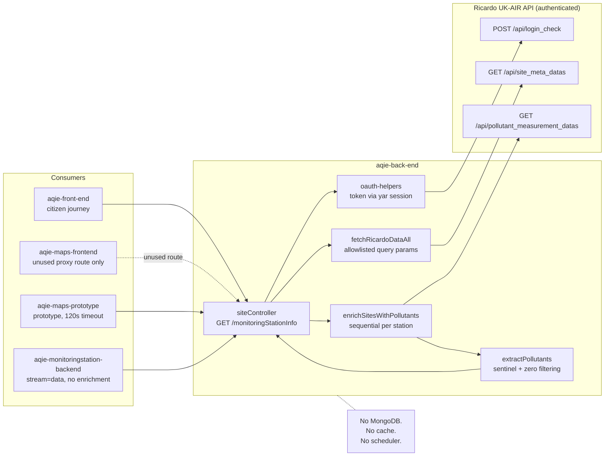

# How `/monitoringStationInfo` collects and serves air quality data

**Status:** current — this is the live measurement-serving endpoint for the AQIE estate.
**Last verified:** 2026-11-19. The `aqie-back-end` statements were checked against `main` at
`77a030c3`, and the consumer statements against `main` at the commits in
[Evidence and provenance](#evidence-and-provenance). The one exception is `aqie-maps-prototype`,
which was last read on 2026-09-23.

Following the removal of `/forecasts` and `/measurements`
([aqie-back-end#163](https://github.com/DEFRA/aqie-back-end/pull/163)),
`GET /monitoringStationInfo` is the endpoint that supplies current pollutant concentrations
to the citizen journey. This document traces that endpoint end to end: where the data comes
from, what the service does to it, what it returns, and who consumes it. A second live
Ricardo read, `GET /monitoringStationHistory` (added later by PR #164, and called by
`aqie-dataselector-frontend`), is described in
[its own section](#a-second-live-endpoint-monitoringstationhistory).

For the decommissioned endpoints and the ingest pipelines that still run behind them, see
[`measurements-data-flow.md`](measurements-data-flow.md).

## Contents

1. [The headline](#the-headline)
2. [System context](#system-context)
3. [Stage 1 — The request](#stage-1--the-request)
4. [Stage 2 — Authentication](#stage-2--authentication)
5. [Stage 3 — Resolve the station list](#stage-3--resolve-the-station-list)
6. [Stage 4 — Enrich each station with pollutants](#stage-4--enrich-each-station-with-pollutants)
7. [Stage 5 — Value cleaning and filtering](#stage-5--value-cleaning-and-filtering)
8. [Stage 6 — Response shaping](#stage-6--response-shaping)
9. [The response contract](#the-response-contract)
10. [Consumers](#consumers)
11. [Request amplification and latency](#request-amplification-and-latency)
12. [Defects and risks found](#defects-and-risks-found)
13. [Timing, freshness and failure](#timing-freshness-and-failure)
14. [A second live endpoint: `/monitoringStationHistory`](#a-second-live-endpoint-monitoringstationhistory)
15. [Comparison with the retired `/measurements`](#comparison-with-the-retired-measurements)
16. [Suggested slide structure](#suggested-slide-structure)
17. [Open questions](#open-questions)
18. [Evidence and provenance](#evidence-and-provenance)

## The headline

Five things are worth stating before the detail, because they change how the endpoint should
be described to a non-technical audience.

**1. Nothing is stored. This endpoint is a live pass-through to Ricardo.** Unlike
`/monitoringStations` and `/aurnData`, which read MongoDB, `/monitoringStationInfo` reads **no
MongoDB collection at all**. Every request triggers a fresh authenticated call chain to the
Ricardo UK-AIR API. There is no cache, no scheduler, and no persistence anywhere in the path.
If Ricardo is slow or unavailable, the citizen journey is slow or unavailable.
(`/monitoringStationHistory`, added by PR #164, is also a live read, but it caches its
responses in process for 15 minutes.)

**2. One citizen request becomes many upstream requests.** For a response covering *N*
stations, the service makes `1 + (5 × N)` calls to Ricardo — one to list the stations, then
five per station, one per pollutant. (A caller that sends `stream=data` skips the
per-station calls.) The per-station loop is **sequential**, so latency grows linearly with
the number of stations returned. Both map clients set a **120-second** client timeout on this
endpoint (`aqie-maps-frontend`, in a helper that nothing in its interface uses, and the
prototype `aqie-maps-prototype`), which is the clearest available evidence of how slow it can
get.

**3. Stations with no valid readings disappear from the response entirely.** A station is
only included if at least one pollutant survives filtering. A monitoring station that exists
and is operating but is currently reporting nothing usable is silently absent — not returned
with empty values. Consumers cannot distinguish "no such station" from "station has no
current data".

**4. A genuine reading of zero is discarded as invalid.** The filter rejects `-9999`, `-99`,
`null`, `'0'` and `0`. The first two are upstream sentinel values for missing data, but `0`
is a legitimate concentration. This is a probable defect — see
[Defects and risks](#defects-and-risks-found).

**5. Request state is held in a process-wide global.** The controller assigns
`globalThis.requestQuery = request.query` on every request, and downstream helpers read from
that global rather than from the request. On a concurrent server this is a cross-request data
leak. This is the most serious finding in this document.

## System context



## Stage 1 — The request

`GET /monitoringStationInfo`, registered as the Hapi plugin `site` in
`src/api/locationsite/index.js`.

Query parameters fall into two groups.

**Forwarded to Ricardo** — an explicit allowlist in `buildqueryparam`:

| Parameter | Purpose |
|---|---|
| `latitude`, `longitude`, `distance` | Proximity search around a point |
| `page` | Upstream pagination |
| `networks[]` | Filter by monitoring network |
| `with-closed` | Include decommissioned stations |
| `with-pollutants` | Include pollutant coverage metadata |
| `start-date` | Earliest data date |

Anything outside this list is dropped. For example, `aqie-front-end` also sends
`latest-measurement` and `daqi-pollutant`, which have no effect here. The URL is assembled
with `URL` and `URLSearchParams`, so parameter injection into the upstream call is not
possible. This is sound and worth keeping.

**Consumed locally, never forwarded:**

| Parameter | Effect |
|---|---|
| `stream` | If `stream=data`, enrichment is skipped entirely and the raw Ricardo payload is returned. `aqie-monitoringstation-backend` is the consumer that uses it |
| `totalItems` | Truncates the station list before enrichment |

Both are read from `globalThis.requestQuery`, not from the request object — see
[Defects and risks](#defects-and-risks-found).

## Stage 2 — Authentication

Unlike the retired `/measurements`, this path is **authenticated**.

1. The controller checks the session for a cached token: `request.yar.get('savedAccessToken')`.
2. If absent, `refreshOAuthToken` calls `fetchOAuthToken`, which `POST`s
   `{ email, password }` to `ricardoApiLoginUrl` (`/api/login_check`).
3. The returned `token` is written back to the session with `request.yar.set`.
4. If no token can be obtained, the request ends with **HTTP 500** and
   `{ error: 'Failed to fetch access token' }`.

Credentials come from `RICARDO_API_EMAIL` and `RICARDO_API_PASSWORD`. The password is marked
`sensitive: true` in the config schema, so it is redacted from config dumps.

The cached token lives in a `yar` session, so it is reused only when the caller returns the
session cookie. A caller that does not return it logs in to Ricardo on every request **(to
confirm for each consumer)**.

> **Configuration hazard.** All four Ricardo URLs default in code to
> `https://uk-air-api.staging.rcdo.co.uk`. Production does not rely on those defaults. All
> four variables are set in the service-wide defaults, none is overridden per environment, and
> none points at the staging host, per CDP environment configuration. The defaults would still
> silently select staging if a variable were removed. See
> [`measurements-data-flow.md`](measurements-data-flow.md#finding-ricardo-staging-defaults-in-code-overridden-in-production).

## Stage 3 — Resolve the station list

`fetchRicardoDataAll` issues a single authenticated `GET` to `ricardoApiAllDataUrl`
(`/api/site_meta_datas`) with the allowlisted parameters.

Error handling is deliberately soft: any thrown error, or any non-object response, is
converted to `{}`. The request then proceeds with an empty station list rather than failing.
**A total upstream outage produces HTTP 200 with an empty result, not an error.**

Each returned member is mapped to the AQIE station shape:

| AQIE field | Ricardo source |
|---|---|
| `name` | `siteName` |
| `area` | `governmentRegion` |
| `localSiteID` | `siteId` |
| `areaType` | `siteType` + `areaType`, concatenated with a space |
| `location.coordinates` | `[latitude, longitude]` |
| `distance` | `distanceFromPoint` |

> **Note the coordinate order.** `location` is declared `type: "Point"`, which implies
> GeoJSON, but GeoJSON requires `[longitude, latitude]`. The code emits `[latitude, longitude]`.
> Consumers must compensate. This mirrors the same inversion found in the retired
> `/measurements` path, so it is estate-wide convention rather than a one-off slip — but it
> is still wrong against the spec it claims to follow.

## Stage 4 — Enrich each station with pollutants

`buildEnrichedTempData` sets the observation window to **today, in server-local terms**: from
`00:00:00` to `23:59:00` on the current date. The date is derived from `new Date()` using
local getters, with no timezone qualifier sent upstream. The window also ends at 23:59:00,
excluding the final minute of the day.

The window is sent to Ricardo as `start-date-time` and `end-date-time`
(`src/api/locationsite/helpers/pollutant-helpers.js:412`). Whether Ricardo honours those two
parameter names is unresolved (catalogue `oq-029`): the `aqie-back-end` README says it
ignores them and returns only the latest measurement, and the history endpoint sends
`start-date` and `end-date` instead. If the README is right, the window above has no effect.

`enrichSitesWithPollutants` then loops over stations. For each station it issues five
parallel requests — one per pollutant in `POLLUTANT_MAP` — to `ricardoApiSiteIdUrl`
(`/api/pollutant_measurement_datas`):

| Short code | Requested upstream as | `data-type` |
|---|---|---|
| `NO2` | `NO2` | not sent |
| `PM10` | **`GE10`** | `24` |
| `PM25` | `PM25` | `24` |
| `O3` | `O3` | `23` |
| `SO2` | `SO2` | not sent |

Two things to note. `PM10` is translated to `GE10` for the upstream call, because Ricardo
uses the gravimetric-equivalent identifier. And `data-type` encodes the averaging period —
24-hour for the particulates, 23 for ozone — while `NO2` and `SO2` are requested without one,
so they return the upstream default.

**The station loop is `for...of` with `await` inside.** Only the five pollutant calls within a
single station run concurrently. Stations are processed strictly one after another.

## Stage 5 — Value cleaning and filtering

For each pollutant response, `extractPollutants`:

1. Normalises pollutant names by stripping `<sub>` tags and whitespace, then matches with
   `startsWith` — Ricardo returns names containing HTML markup.
2. Where several records match, picks the one with the **latest `endDateTime`**.
3. Calls `validateDataFreshness`, which logs an error if the reading is more than
   **65 minutes** old. This is logging only — stale data is still returned.
4. Optionally corrupts the value if `MOCK_INVALID_POLLUTANTS` is enabled (default `false`).
   When on, there is a 90% chance per value of substituting an invalid sentinel.
5. Rounds non-integer values to two decimal places.
6. Converts the unit to `μg/m3` when the upstream unit string starts with
   `microgrammes per cubic metre`, otherwise `NA`.
7. **Filters the value**, dropping it if it equals `-9999`, `-99`, `null`, `'0'` or `0`.

A station with zero surviving pollutants is **excluded from the response**.

### Timestamp handling is non-standard

`parseWithOffsetAdded` takes a timestamp such as `2026-07-28T01:00:00+01:00` and **adds** the
offset to the literal time, producing `02:00:00`. Standard ISO 8601 parsing subtracts the
offset to reach UTC, which would give `00:00:00Z`. The behaviour is deliberate and commented,
but it means emitted timestamps are not straightforwardly UTC.

Separately, `getTimeComponents` branches on the timestamp format: values ending in `Z` are
read as literal UTC with no conversion, while offset timestamps are converted to
`Europe/London`. The displayed hour therefore depends on which format Ricardo happened to
return.

**This is worth a slide on its own.** Both behaviours are intentional, both are documented in
code comments, and both are surprising.

## Stage 6 — Response shaping

The controller builds a human-readable `message` naming **only the first three stations**,
padding with `Not Available` where fewer than three are present:

```
Monitoring Stations Info for Aberdeen - Bristol St Pauls - Not Available
```

If the enriched list is empty, the message becomes
`There are currently not monitoring stations for that station id.` — note the grammatical
error and that it references a station id even for proximity searches.

## The response contract

**Default mode** — HTTP 200:

```json
{
  "message": "Monitoring Stations Info for <name> - <name> - <name>",
  "measurements": [
    {
      "name": "Aberdeen",
      "area": "Scotland",
      "localSiteID": "ABD",
      "areaType": "Urban Background",
      "location": { "type": "Point", "coordinates": [57.15736, -2.094278] },
      "distance": 1.23,
      "pollutants": {
        "NO2": {
          "value": 12.4,
          "unit": "μg/m3",
          "startDate": "2026-09-23",
          "endDate": "2026-09-23T14:00:00.000Z",
          "time": { "date": "2026-09-23T14:00:00.000Z", "hour": "2pm", "day": "23", "month": "September", "year": "2026" }
        }
      }
    }
  ]
}
```

**`stream=data` mode** — HTTP 200, enrichment bypassed, raw upstream payload:

```json
{ "measurements": { "member": [ ... ], "totalItems": 1234 } }
```

The `measurements` key holds an **array** in default mode and an **object** in stream mode.
Consumers must branch on shape. The key name is also a legacy of the retired endpoint and no
longer matches the endpoint name.

**Error** — HTTP 500, token failure only:

```json
{ "error": "Failed to fetch access token" }
```

## Consumers

| Consumer | How it calls | Verified |
|---|---|---|
| `aqie-front-end` | **Live.** Used for every runtime request, through `NEW_RICARDO_MEASUREMENTS_API_URL`. The English controller hard-codes the new source and the shared fetch forces it for any argument that is not a boolean, so `USE_NEW_RICARDO_MEASUREMENTS_ENABLED` does not gate the call; the flag only selects the response parser in the Welsh controller. It asks for at most three stations near the searched point (`totalItems=3`) | Confirmed in code on `main` at `210c0c03`, 2026-11-19 (`src/server/locations/helpers/fetch-data.js:152–171`; `src/server/location-id/controller.js:96` and `:171`; Welsh `src/server/location-id/cy/controller.js:371–373`). `NEW_RICARDO_MEASUREMENTS_API_URL` is set, and the flag is `true`, in every environment, per CDP environment configuration |
| `aqie-maps-frontend` | **Not a live consumer.** `src/server/common/helpers/aqie-back-end.js` can call this endpoint (**120000 ms timeout**), but only through its proxy route `GET /api/monitoring-station-info`, which nothing in its interface calls (security finding 50). Its live data comes from `/aurnData` and `/monitoringStations` | Confirmed in code on `main` at `13a9eb7f`, 2026-11-19 (`src/server/routes/api/monitoring-stations/index.js:16–20`) |
| `aqie-maps-prototype` | `app/api/aqieBackEnd.js`, same 120000 ms timeout, exposed at `/monitoringStationInfo`. A prototype, superseded by `aqie-maps-frontend` | Confirmed in code on 2026-09-23; not re-read on 2026-11-19 |
| `aqie-monitoringstation-backend` | **Live.** `GET /monitoringStationInfo?with-closed=true&with-pollutants=1&stream=data` on every `POST /monitoringstation` request (its station search; catalogue `oq-009` is answered as POST), and on a schedule to refresh a reference cache of stations: at start-up, then every six hours by default (`STATIONS_SYNC_SCHEDULE`). Both use the `stream=data` branch, which skips the per-station enrichment | Confirmed in code on `main` at `ad63bb7f`, 2026-11-19 (`src/api/location/helpers/fetch-data.js:31–37` and `:56–62`); catalogue `oq-014` answered |
| `aqie-dataselector-frontend` | **Not this endpoint: it calls the second live endpoint, `GET /monitoringStationHistory`** (last 24 hours and last 7 days for one station), through `MONITORING_STATION_HISTORY_URL`. See [the section below](#a-second-live-endpoint-monitoringstationhistory) | Confirmed in code on `main` at `41776ca8`, 2026-11-19 |

`aqie-front-end` is the only consumer of `/monitoringStationInfo` on the check air quality
journey. `aqie-monitoringstation-backend` is the only other live caller, and its use is
indirect: it serves the station search in `aqie-dataselector-frontend`, so each citizen
search there makes one `stream=data` call here. When this endpoint fails, that service
answers its own caller with HTTP 400 (since its PR #51), and whether that is intended is
catalogue `oq-028`. The map does not use this endpoint. Its live data comes from `/aurnData`,
whose stale-index problem is catalogue `oq-030` (see
[`measurements-data-flow.md`](measurements-data-flow.md#failure-modes)).

## Request amplification and latency

For a response covering *N* stations:

| Calls to Ricardo | Purpose |
|---|---|
| 1 | OAuth login, when no session token is cached |
| 1 | `site_meta_datas` station listing |
| 5 × *N* | `pollutant_measurement_datas`, one per pollutant per station |

So a 10-station response is around **52 upstream calls**, with the per-station groups running
sequentially. A 50-station response is around 252.

The citizen journey asks for three stations (`totalItems=3`), so each of its page loads costs
up to 17 Ricardo calls: a login when no token is cached, one listing call and 15 pollutant
calls. A caller that sends `stream=data`, as `aqie-monitoringstation-backend` does, skips the
per-station calls: one listing call, plus a login, however many stations come back. The
`aqie-dataselector-frontend` history calls go to the other endpoint and cost five calls per
cache miss. Whether Ricardo has agreed this request-time load is catalogue `oq-031`.

Three compounding factors:

- **No caching.** Two identical requests one second apart do the same work twice.
- **No retries.** A single failed pollutant call silently yields no data for that pollutant.
- **No upstream timeout in the back end.** The 120-second budget lives in the map *clients*.

This is the most likely source of citizen-visible latency in the estate, and the strongest
candidate for a caching layer — the pattern already used by `/monitoringStations`, which
serves from a MongoDB cache refreshed every six hours with zero Ricardo calls per request.

## Defects and risks found

Ordered by severity. None of these is a conclusion about production behaviour; each is a
code-level finding that should be confirmed before being acted on.

### 1. Cross-request global state — `globalThis.requestQuery`

The controller in `src/api/locationsite/controller.js` assigns the request's query object to
the process-wide `globalThis.requestQuery` on every request.

`buildEnrichedTempData` then reads `globalThis.requestQuery.totalItems`. Node serves requests
concurrently on a single thread, so between the assignment and the read, **another request can
overwrite the global**. Request A can therefore be truncated using request B's `totalItems`,
and the `stream` check in the controller has the same exposure.

The parameters involved are not sensitive, so this is a correctness and stability problem
rather than a data-protection one. The fix is to pass `request.query` through the call chain
as an argument, which is already how every other parameter in this module is handled.

### 2. Legitimate zero readings are discarded

The filter in `extractPollutants` rejects `0` and `'0'` alongside the genuine sentinels
`-9999` and `-99`. A true zero concentration is valid data. Because a station is dropped when
no pollutant survives, a station legitimately reading zero across the board vanishes from the
response.

### 3. Silent degradation to empty results

Upstream failures are caught and converted to empty values at three separate points: the
station listing, each pollutant fetch, and the enrichment filter. The endpoint returns
HTTP 200 throughout. Only a token failure produces a non-200. A consumer cannot distinguish
"no data exists" from "the upstream is down".

### 4. Mock mode can corrupt production values

`MOCK_INVALID_POLLUTANTS` is read from config at request time, not build time. If it were
ever set in a deployed environment, 90% of values would be replaced with invalid sentinels.
The default is `false`. This document has not verified the deployed setting in any
environment, so treat it as a latent hazard and confirm that it is unset everywhere.

### 5. GeoJSON coordinate order

`[latitude, longitude]` under a `type: "Point"` declaration, as described in Stage 3.

### 6. Verbose logging of full payloads

`extractPollutants` and `enrichSitesWithPollutants` log entire upstream payloads with
`JSON.stringify` at `info` level, once per station per pollutant. At 5 × *N* calls per
request this is a significant log volume and cost. The data is not personal, but the volume
is worth reviewing.

### 7. Residual coupling to the `pollutants` module

Twelve modules across the service import shared constants, and `pollutant-helpers.js` also
imports `validateDataFreshness`, from `src/api/pollutants/helpers/common/`. They include this
endpoint's controller and helpers, the new history endpoint, the AURN and station controllers,
the SFTP controllers and the shutdown hook in `src/common/helpers/pulse.js`. That directory
survived the endpoint removal, and the SOS ingest it belongs to still runs. Retiring that
ingest (catalogue `oq-019`) therefore means relocating those shared utilities first.

## Timing, freshness and failure

| Property | Behaviour |
|---|---|
| Data age | Whatever Ricardo returns for today; no AQIE-side caching or scheduling |
| Staleness signal | Logged as an error above 65 minutes; never surfaced to the consumer |
| Observation window | Server-local `00:00:00` to `23:59:00` for the current date |
| Retries | None anywhere in the path |
| Back-end timeout | None; the map clients apply 120 s |
| Token caching | Per session, via `yar` |

| Failure | Result |
|---|---|
| OAuth login fails | HTTP 500, `Failed to fetch access token` |
| `site_meta_datas` fails or returns a non-object | HTTP 200, empty list, "not monitoring stations" message |
| A single pollutant call fails | That pollutant is absent; the station may still be returned |
| All pollutants fail for a station | Station omitted from the response entirely |
| Ricardo slow | Latency passed straight through to the citizen; the map clients give up at 120 s |

## A second live endpoint: `/monitoringStationHistory`

Added by PR #164 (2026-10-15) and reshaped by PRs #165 (2026-10-30) and #169 (2026-11-16).
Registered as the Hapi plugin `monitoringStationHistory` in
`src/api/locationsite/history-index.js`. It reuses the Ricardo login and session-token helpers
and the same fetch wrapper as `/monitoringStationInfo`, and likewise has no back-end timeout
and no retries. Its consumer is `aqie-dataselector-frontend`, confirmed in code on `main` at
`41776ca8` (config key `monitoringStationHistoryUrl`, variable `MONITORING_STATION_HISTORY_URL`,
`src/config/config.js:268–272`; call `fetchStationHistory`,
`src/server/common/helpers/station-helpers.js:197–219`). The station page calls it for its
Last 24 hours, Last 7 days and DAQI tabs (the DAQI tab is behind `VIEW_DAQI_TAB_ENABLED`, off
by default in code), and a station without a Ricardo-form `siteId` never triggers the call.

| | `/monitoringStationInfo` | `/monitoringStationHistory` |
|---|---|---|
| Scope | Stations near a point; newest reading per pollutant | One station; an hourly series per pollutant |
| Input | Allow-listed filters | `siteId` (Ricardo form such as `UKA00315`, checked against a pattern) and `period` (`24h`, the default, or `7d`); anything else is HTTP 400 |
| Ricardo calls | 1 + 5 × *N* | 5, in parallel: PM2.5, PM10 (requested as `GE10`), NO₂, O₃ and SO₂ |
| Dates sent upstream | Today only, as `start-date-time` and `end-date-time` (whether Ricardo honours these is catalogue `oq-029`) | Whole days as `start-date` and `end-date`, starting two days earlier than the window needs |
| Caching | None | In process, 15 minutes, 500 entries, keyed on station and period; successful responses only |
| Login or upstream failure | HTTP 500 on login failure; otherwise empty data with HTTP 200 | HTTP 502 on login failure or if any pollutant call fails |
| Computation | Value cleaning only | Averages, data capture, exceedances and DAQI |

What the response holds:

- **A window anchored on the newest reading**, not on the clock: 24 hourly points for `24h`, 168
  for `7d`, every time being the **end** of its averaging period. Invalid readings (`-9999`,
  `-99`, any negative value) stay in the series as `null` so that data capture can be counted
  against them.
- **SO₂ at 15 minutes.** Hourly SO₂ is derived from 15-minute means (at least 3 of 4) when
  Ricardo supplies them, and the 15-minute series is returned as well. A `truncated` flag shows
  that a pollutant hit the 10,000-row cap that Ricardo applies silently.
- **A computed summary** per pollutant and overall: the period average (withheld unless at
  least 75% of the window's hours are valid; for `7d`, the mean of the valid daily means), data
  capture counts, a low-capture flag, exceedance counts against legal limits (hourly NO₂ 200 and
  SO₂ 350; daily PM10 50 and SO₂ 125, in µg/m³, compared on the rounded mean), daily means, and
  the DAQI concentration, index and averaging period. The overall `daqiIndex` is the highest
  pollutant index. The rules are the shared ones in `src/common/helpers/averaging.js`.
- **Clock-change handling.** At the autumn BST to GMT change Ricardo can return rows that are
  neither 60 nor 15 minutes long. They are treated as missing and logged as a warning.

## Comparison with the retired `/measurements`

Useful for a "what changed" slide.

| | `/measurements` (removed) | `/monitoringStationInfo` (current) |
|---|---|---|
| Source | DEFRA UK-AIR SOS/AQD, public | Ricardo UK-AIR API, authenticated |
| Storage | MongoDB `measurements`, hourly cron | None — live pass-through |
| Latency | One unfiltered collection read | 1 + 5*N* upstream calls, sequential |
| Auth | None | OAuth token, session-cached |
| Availability | Survived upstream outages by serving cached data | Fails soft to empty results |
| Feature-of-interest mapping | Published | Not published |
| Consumers | None with traffic when it was removed. The front end's legacy branch cannot be reached at runtime | `aqie-front-end` and `aqie-monitoringstation-backend` |
| Response key | `measurements` | `measurements` (unchanged) |

The architectural shift is from **cache-and-serve** to **live proxy**. That removed a whole
ingest pipeline from the read path, but transferred the availability and latency of the
citizen journey directly onto a third-party API.

## Suggested slide structure

1. **Title** — How AQIE serves air quality measurements today
2. **What changed** — `/measurements` and `/forecasts` removed; `/monitoringStationInfo` is the live path, and `/monitoringStationHistory` has been added
3. **The headline** — nothing is stored; this is a live proxy
4. **System context** — the Mermaid diagram above, rendered in draw.io
5. **The request** — allowlisted parameters, two local-only parameters
6. **Authentication** — OAuth to Ricardo, session-cached token
7. **The fan-out** — the `1 + 5N` diagram; this is the slide that will land
8. **Value cleaning** — sentinels, the zero problem, the 65-minute staleness log
9. **The timestamp oddity** — offset added rather than subtracted
10. **The response** — annotated JSON, and the two shapes of `measurements`
11. **Consumers** — who calls it (the front end and the monitoring station service; the map's route is unused), and the 120-second timeouts in the map clients
12. **A second live endpoint** — `/monitoringStationHistory` and its consumer, the data selector: five calls, a 15-minute cache, a computed summary
13. **Cache-and-serve versus live proxy** — the comparison table
14. **Risks** — the global state bug, silent degradation, the staging defaults in code as an unsafe fallback
15. **Open questions**

For diagram conventions follow
[`/docs/diagrams/drawio-guidelines.md`](../diagrams/drawio-guidelines.md) and the prompt
pattern in [`/draw-io-generation/prompts/`](../../draw-io-generation/prompts/README.md).

## Open questions

| # | Question | Why it matters |
|---|---|---|
| 1 | Do the production Ricardo URLs resolve to staging? | **Answered 2026-11-19 for `aqie-back-end`: no**, per CDP environment configuration (see the finding in [`measurements-data-flow.md`](measurements-data-flow.md#finding-ricardo-staging-defaults-in-code-overridden-in-production); catalogue `oq-012`, partly answered, because the `aqie-alert-back-end-service` half was not re-read). What remains is that the staging defaults in code would silently apply if a variable were removed. |
| 2 | Is the `0` filter deliberate? | It discards valid readings and can remove whole stations. |
| 3 | Is `globalThis.requestQuery` a known issue? | Concurrency bug affecting response truncation (security finding 64). |
| 4 | Was a cache considered for this endpoint? | `/monitoringStations` already demonstrates the pattern in the same service, and `/monitoringStationHistory` now caches in process. |
| 5 | What is the observed p95 latency and typical station count in production, and has Ricardo agreed the request-time load? | Determines whether the `1 + 5N` fan-out is a real problem or a theoretical one. Catalogue `oq-031`, open. |
| 6 | Does `aqie-monitoringstation-backend` call this endpoint? | **Answered 2026-11-19: yes** (catalogue `oq-014`). It calls with `stream=data` on every `POST /monitoringstation` request (`oq-009` is answered as POST) and on a schedule. Still open: that service answers HTTP 400 when the call fails (catalogue `oq-028`). |
| 7 | Is the offset-adding timestamp behaviour matched by consumers? | **Answered for `aqie-front-end`: no re-conversion.** It shows the hour, day, month and year exactly as given (`src/server/locations/helpers/get-nearest-location.js:84–98` in that repository), so times are not shifted twice. `aqie-monitoringstation-backend` uses `stream=data`, which carries no converted times. `aqie-maps-prototype` was not re-read. |
| 8 | Should `measurements` be renamed in the response? | The key is a legacy of a removed endpoint. |
| 9 | Do consumers return the session cookie, so that the Ricardo token is actually reused? | If not, every request logs in to Ricardo again. Not verified for any consumer; catalogue `oq-031` raises the same point. |
| 10 | Is `MOCK_INVALID_POLLUTANTS` unset in every deployed environment? | If set, about 90% of values are replaced with invalid markers. Not verified here. |
| 11 | Does Ricardo honour `start-date-time` and `end-date-time`? | Catalogue `oq-029`, open. This endpoint and the `/aurnData` job send them, and the `aqie-back-end` README says Ricardo ignores them. If so, the daily window has no effect, and the 75% capture rule on `/aurnData` can never be met for PM2.5, PM10 and O₃. |

## Evidence and provenance

The first pass (2026-09-23) used local clones that were not on `main`. Every
repository except the prototype was then re-read on 2026-11-19, each on `main` at a pinned
commit. The `aqie-back-end` statements were re-verified in full against `main` at
`77a030c3cf1548e5cee23f000eccbd3d32f451d1` (2026-11-16), which includes the merge of
[PR #163](https://github.com/DEFRA/aqie-back-end/pull/163) and the later PRs #164, #165, #166,
#167 and #169. The `aqie-front-end` analysis is re-grounded on `main`: the flag handling, the
call sites and the DAQI banding were re-read at `210c0c03`, because the first pass had not
read `main`.

| Repository | Branch | Commit |
|---|---|---|
| `aqie-back-end` | `main` | `77a030c3cf1548e5cee23f000eccbd3d32f451d1` (2026-11-16) |
| `aqie-front-end` | `main` | `210c0c03b66ee2c931de10c4af67a77c7735a7cd` (2026-11-05) |
| `aqie-maps-frontend` | `main` | `13a9eb7f4064dfff7128689ebbcf276062559adf` (2026-11-18) |
| `aqie-monitoringstation-backend` | `main` | `ad63bb7fcc3bd4f97862a99767dd87a997d51b29` (2026-11-16) |
| `aqie-dataselector-frontend` | `main` | `41776ca8758e69ee480f6ea5ce4be1814025fe67` (2026-11-19) |
| `aqie-maps-prototype` | not recorded | not re-read; last read on 2026-09-23 as cloned |

**Caveat.** `aqie-maps-prototype` was not re-read, so its row in the consumers table rests on
the 2026-09-23 reading. Statements that cite CDP environment configuration come from private
deployment configuration. They give only variable names and set or true states, and they show
configuration, not observed traffic.

### Key source files — `aqie-back-end`

| Concern | File |
|---|---|
| Route registration | `src/api/router.js` |
| Endpoint definition | `src/api/locationsite/index.js` |
| Controller | `src/api/locationsite/controller.js` |
| OAuth | `src/api/locationsite/helpers/oauth-helpers.js` |
| Station listing and parameter allowlist | `src/api/locationsite/helpers/fetch-ricardo-data-all.js` |
| Enrichment orchestration | `src/api/locationsite/helpers/build-enriched-temp-data.js` |
| Pollutant extraction, filtering, timestamps | `src/api/locationsite/helpers/pollutant-helpers.js` |
| History endpoint | `src/api/locationsite/history-index.js`, `history-controller.js`, `helpers/fetch-pollutant-history.js`, `helpers/build-history-summary.js` |
| Shared data-capture and averaging rules | `src/common/helpers/averaging.js` |
| Shared constants and freshness check | `src/api/pollutants/helpers/common/` |

## Related documentation

- [`measurements-data-flow.md`](measurements-data-flow.md) — the decommissioned `/measurements`
  path and the ingest pipelines that still run
- [`system-landscape.md`](system-landscape.md)
- [`/docs/services/data/aqie-back-end/service-profile.md`](../services/data/aqie-back-end/service-profile.md)
- [`/docs/integration-catalog.yaml`](../integration-catalog.yaml)
