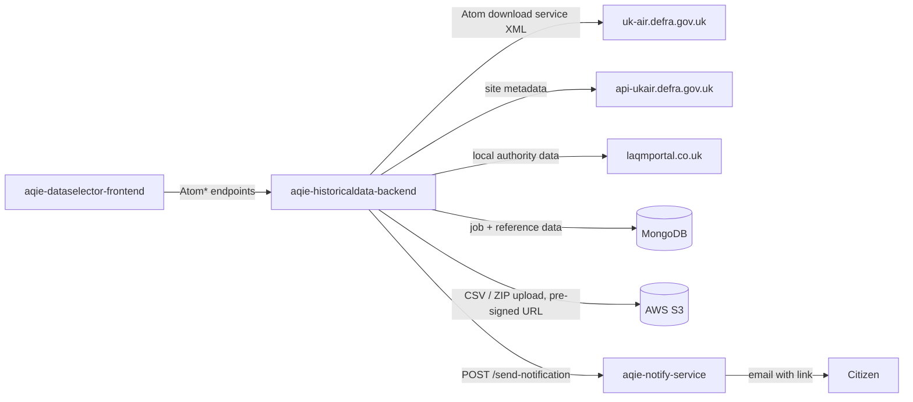

# aqie-historicaldata-backend

> The engine behind the historic air quality data download journey. It fetches measurement
> series on demand from the DEFRA UK-AIR Atom download service, builds CSV and ZIP extracts,
> stores them in S3, and issues pre-signed download links — either straight back to the
> browser or by email for long-running extracts.

## 1. Service Metadata

| Field | Value |
|---|---|
| Repository | [`DEFRA/aqie-historicaldata-backend`](https://github.com/DEFRA/aqie-historicaldata-backend) |
| Service domain | `Data` |
| Service type | `Auxilary Backend Service` |
| Lifecycle stage | `Production` |
| Primary language | C# |
| Runtime | .NET 8 (`net8.0`, Microsoft support ended 10 November 2026), ASP.NET Core minimal APIs |
| Default branch | `main` |
| Created (UTC) | `2025-02-24` |
| Last main commit (UTC) | `2026-11-18T14:41:24Z` |
| Last analysed commit | `73a763ab` |
| Last analysed (UTC) | `2026-11-19T00:00:00Z` |
| Activity status | `Active` |

## 2. Purpose and Responsibilities

**Does:**

- Serves the historic data selection journey for `aqie-dataselector-frontend` through eleven
  `Atom*` minimal-API endpoints (twelve route registrations, because `AtomHistoryHourlydata`
  accepts both `GET` and `POST`).
- **Fetches source measurements on demand** from the DEFRA UK-AIR INSPIRE Atom download
  service — see Section 7, "How this service gets its data", which answers catalogue open
  question `oq-002`.
- Resolves which monitoring sites are relevant to a selection. For the AURN network it
  authenticates to the Ricardo UK-AIR API and reads site metadata; for non-AURN networks it
  reads a station master list held in MongoDB. Networks 10, 11 and 13 (which include the
  Automatic Hydrocarbon Network) take their site list from that MongoDB list but are then
  treated as AURN, so their feeds come from the `auto` Atom path.
- Filters sites by area. By country it tests each site against GeoJSON boundary files for
  England, Scotland, Wales and Northern Ireland using `NetTopologySuite`, with the
  boundaries loaded once at start-up. By local authority it keeps sites within about five
  miles (8,046 metres) of the authority's diffusion tube points. For AURN it can also filter
  on Ricardo region or agglomeration identifiers, and records the country of each site.
- Serves the master lists of Ricardo regions and agglomerations that the frontend offers as
  choices, built from the same Ricardo site metadata.
- Resolves local authority areas and their diffusion tube locations from the LAQM portal
  API, converting OS grid eastings and northings to latitude and longitude with `ProjNET`.
- Aggregates raw hourly observations into hourly, daily or annual CSV exports, and packages
  multi-site data selections as ZIP archives. For AURN, a "last 7 days" selection means the
  seven full days before today, excluding today.
- Runs single downloads (`dataSelectorSingle`) as **asynchronous jobs**. A job is written to
  MongoDB, processed on a background channel, and its state is pollable. Other multi-site
  extracts are built inside the request that asks for them, or by the email job sweep below.
- Uploads completed extracts to S3 and generates a pre-signed download URL valid for seven
  days.
- Runs a background service that picks up pending email jobs on an interval, rebuilds each
  extract, and asks `aqie-notify-service` to email the citizen a link to a download page on
  the frontend.
- Seeds pollutant and station reference data into MongoDB from spreadsheets held in S3 on
  every start-up, and again on request.
- Calculates exceedence statistics for a station and year.

**Does not:**

- Serve current or near-real-time air quality. Today's concentrations and DAQI are
  `aqie-back-end`; the forecast is `aqie-forecast-api`. `aqie-dataselector-frontend` now uses
  both `aqie-back-end` and this service: `aqie-back-end` `GET /monitoringStationHistory`
  (`siteId` and `period` of `24h` or `7d`) returns one station's live hourly readings and
  summary for the last 24 hours or 7 days, while this service supplies the historic side,
  meaning extracts and yearly exceedance figures built from UK-AIR, and does not call
  `aqie-back-end`.
- Store the historic measurements themselves. It holds job state and reference data only —
  the measurement series are re-fetched from UK-AIR for each extract.
- Resolve place names. `aqie-dataselector-frontend` calls `aqie-location-backend` and
  `aqie-monitoringstation-backend` for that before it ever reaches this service.
- Send email itself. It has no GOV.UK Notify credentials; it delegates to
  `aqie-notify-service`.
- Render any user interface — that is `aqie-dataselector-frontend`.
- Manage alert subscriptions — that is `aqie-alert-back-end-service`.

## 3. Architecture

**Pattern:** ASP.NET Core minimal API with three hosted services (the email job sweep, the
reference-data seed and the boundary warm-up), an in-process job queue backed by MongoDB job
documents, and S3 as the artefact store.

| Component | Path | Responsibility |
|---|---|---|
| Endpoint registration | `Atomfeed/Endpoints/AtomHistoryEndpoints.cs` | Maps all twelve `Atom*` route registrations |
| Facade | `Atomfeed/Services/AtomHistoryService.cs` | Single entry point the endpoints call; dispatches to the specialist services |
| Atom fetch base | `Atomfeed/Services/AtomFeedFetchServiceBase.cs` | Builds the UK-AIR Atom path, handles 304/404/428, parses the XML |
| Fetch services | `AtomHourlyFetchService`, `AtomDailyFetchService`, `AtomAnnualFetchService`, `AtomDataSelectionHourlyFetchService` | Period-specific fetch and aggregation |
| Feed parsing | `Atomfeed/Services/AtomFeedHelper.cs` | OM/SWE observation parsing, pollutant identifier extraction |
| Station resolution | `AtomDataSelectionStationService` | Orchestrates a selection: resolves the sites, applies the filters, then returns a count, queues a job or builds the extract. Hosts the in-process job queue |
| Site rules | `AtomSiteFilterHelper`, `AuthService`, `RicardoSiteMetadata` | Data source and network rules, pollutant, year, region and agglomeration filters, the non-AURN site lookup in MongoDB; Ricardo login and site metadata parsing |
| Region and agglomeration | `AtomRegionService`, `AtomAgglomerationService`, `RegionMaster`, `AgglomerationMaster`, `RegionCountryMapper`, `AgglomerationCountryMapper` | Master lists built from Ricardo site metadata; hard-coded name and country mappings |
| Geography | `AtomDataSelectionStationBoundryService`, `GeoBoundary.cs` (`GeoBoundaryProvider`, `GeoBoundaryWarmupHostedService`), `GeoBoundaries/*.geojson` | Country containment tests against boundaries loaded once at start-up; local authority proximity filter |
| Local authorities | `AtomDataSelectionLocalAuthoritiesService` | LAQM portal calls and grid-reference conversion |
| CSV export | `HourlyAtomFeedExportCSV`, `DailyAtomFeedExportCSV`, `AnnualAtomFeedExportCSV`, `DataSelectionHourlyAtomFeedExportCSV` | CSV generation via `CsvHelper` |
| S3 | `AWSS3BucketService`, `AWSPreSignedURLService` | Upload and pre-signed URL generation |
| Job state | `AtomDataSelectionJobStatus` | Reads job documents from MongoDB |
| Email jobs | `AtomDataSelectionEmailJobService`, `AtomDataSelectionEmailJobHostedService`, `AtomDataSelectionPresignedUrlMail` | Registers email jobs, sweeps pending ones on an interval, rebuilds the extract and notifies; regenerates a pre-signed URL when the citizen opens the link |
| Reference seeding | `AtomDataSelectionNonAurnNetworks`, `AtomNonAurnNetworksSeedHostedService` | Loads spreadsheets from S3 into MongoDB at every start-up and on request |
| Exceedences | `HistoryexceedenceService` | Exceedence statistics |
| Platform utilities | `Utils/Mongo/`, `Utils/Http/ProxyHttpMessageHandler.cs`, `Utils/TrustStore.cs`, `Utils/Logging/CdpLogging.cs` | CDP conventions |
| Example scaffold | `Example/` | CDP template sample with five routes, still registered — see Section 11 |

### The extract job lifecycle

The download type on the request chooses the route to a finished extract. The frontend sends
`dataSelectorSingle` for a direct download and `dataSelectorMultiple` for an email request.

**Direct download (`dataSelectorSingle`):**

1. The frontend posts a selection to `AtomDataSelection`. For a count request
   (`dataSelectorCount`) the service returns a station count, or a count per network type,
   immediately.
2. For a download request it creates a job document in `aqie_csvexport_jobs` with status
   `Pending`, queues the work on an unbounded in-process channel and returns the job
   reference.
3. The worker marks the job `Processing`, resolves the relevant sites, fetches one Atom feed
   per site and year from UK-AIR (one at a time), maps observations to pollutants, and
   builds the ZIP.
4. The artefact is uploaded to S3 under a key derived from the selection, and a pre-signed URL
   valid for `604800` seconds (seven days) is generated. The job becomes `Completed` with
   the URL, or `Failed` with a reason.
5. The frontend polls `AtomDataSelectionJobStatus` with the job reference until the state is
   terminal, then uses the result URL.

**Email delivery (`dataSelectorMultiple`):**

6. `AtomEmailJobDataSelection` records a `Pending` job in `aqie_csvemailexport_jobs` holding
   the selection criteria and the recipient's email address, and answers `Success`. Nothing
   is built at this point.
7. The hosted sweep runs at start-up and then `TIME_INTERVAL` minutes (default 45) after each
   run. It claims each pending job atomically (`Pending` to `Processing`), so several
   containers can share the work, then **rebuilds the whole extract** from the stored
   criteria inside the sweep, uploads it to S3, and posts to `aqie-notify-service`
   `POST /send-notification` with the recipient, a Notify template identifier and a link as
   personalisation. The link is a frontend page (`EMAIL_BASEADDRESS` plus the job reference
   and the creation time in Unix milliseconds). The job ends `Completed` or `Failed` with a
   reason.
8. When the citizen opens the link, the frontend (which refuses links older than 48 hours)
   calls `AtomDataSelectionPresignedUrlMail`, and this service generates a fresh seven-day
   pre-signed URL for the stored extract.

> Because the in-process channel is per container, a queued direct-download job is bound to
> the container that accepted it. Job state is durable in MongoDB, but nothing re-drives a
> job after a container is replaced, and the email sweep reads only `Pending` jobs, so an
> interrupted job stays in `Pending` or `Processing`. See Section 11.

## 4. API Surface

Routes are registered without a leading slash in `AtomHistoryEndpoints.cs`, which ASP.NET Core
maps to the paths below.

| Method | Path | Purpose | Request | Response |
|---|---|---|---|---|
| `GET` | `/health` | Liveness probe (ASP.NET Core health checks, with none registered) | — | Health status |
| `GET` / `POST` | `/AtomHistoryHourlydata` | Single-station extract for a site and year: builds the hourly, daily or annual CSV and uploads it to S3 | Site, year, pollutant and frequency | A pre-signed download URL (empty if the build failed), or 404 |
| `POST` | `/AtomHistoryexceedence` | Exceedence statistics for a station and year | Site and year | Exceedence summary, or 404 |
| `POST` | `/AtomDataSelection` | Station or network count, or start an extract | Pollutant identifiers, year, region, region type, region and agglomeration identifiers, data source, network, filter type, download type, optional `Days` | A count (a number for AURN, counts per network type otherwise), a job reference (`dataSelectorSingle`) or a pre-signed URL (other download types); `Failure` on error |
| `POST` | `/AtomDataSelectionJobStatus` | Poll a direct-download job | Job reference | Job state, result URL, error reason, created/updated/start/end timestamps |
| `POST` | `/AtomEmailJobDataSelection` | Register an email extract job | Selection criteria and recipient email address | `Success` or `Failure` |
| `POST` | `/AtomDataSelectionPresignedUrlMail` | Regenerate the pre-signed URL for an email job | Job reference | Pre-signed download URL |
| `POST` | `/AtomDataSelectionNonAurnNetworks` | Operations trigger: drop and reload one reference collection from its S3 spreadsheet (the pollutant master when `SiteName` is `Pollutant`, otherwise station details) | `SiteName` | `Success` or `Failure` |
| `GET` | `/AtomDataSelectionPollutantMaster` | Master list of selectable pollutants | — | Pollutant master records |
| `POST` | `/AtomDataSelectionPollutantDataSource` | Data sources available for the chosen pollutants, in two categories | Pollutant identifiers | Categories of networks, each with the pollutant identifiers it covers |
| `GET` | `/AtomDataSelectionRegionMaster` | Master list of Ricardo regions, built from site metadata | — | Region identifier and name, or 404 |
| `GET` | `/AtomDataSelectionAgglomerationMaster` | Master list of agglomerations, built from site metadata | — | Agglomeration identifier or identifiers and name, or 404 |
| `POST`, `GET`, `PUT`, `DELETE` | `/example`, `/example/{name}` | CDP template scaffold — not part of the service contract | Sample documents | Sample documents |

Handlers catch broadly. A failure that reaches the handler returns `404 Not Found`, and many
failures are caught earlier and returned as the text `Failure` with status 200, so a
downstream failure is not distinguishable from an empty result. There is no authentication of
any kind. See Section 11.

## 5. Consumes (Outbound Dependencies)

| Target | Type | Endpoint / Mechanism | Data exchanged | Auth |
|---|---|---|---|---|
| DEFRA UK-AIR Atom download service | External API | `GET /data/atom-dls/observations/auto/GB_FixedObservations_{year}_{siteID}.xml` and `.../non-auto/...` | INSPIRE/OM-SWE observation XML — the actual historic measurements, fetched one site and year at a time. The `auto` path serves AURN, networks 10, 11 and 13, and the single-station journey; `non-auto` serves other non-AURN networks | None (public) |
| Ricardo UK-AIR API | External API | `POST /api/login_check`, then `GET /api/site_meta_datas?with-closed=true&with-pollutants=1` | Credentials exchanged for a bearer token; AURN site metadata, pollutant coverage and region and agglomeration identifiers out. Not cached: every AURN selection and every region or agglomeration master call logs in and downloads the full list again | `RICARDO_API_KEY` / `RICARDO_API_VALUE` |
| LAQM portal API | External API | `GET /xapi/getLocalAuthorities/json`, `GET /xapi/getSingleDTDataByYear/{year}/{laId}/{page}/{perPage}/json` | Local authority list and diffusion tube data with OS grid references (previous calendar year, first page of 100 rows), used to select sites near a local authority | `X-API-Key` and `X-API-PartnerId` headers (`LAQM_API_KEY`, `LAQM_USERID`) |
| `aqie-notify-service` | `AQIE service` | `POST /send-notification` (`NOTIFY_BASEADDRESS` + `NOTIFY_URL`), sent with a bare `HttpClient` rather than the proxy-aware named client | Recipient email address, Notify template identifier, and the link to the frontend download page as personalisation | CDP internal network |
| AWS S3 | Datastore | `GetObject`, `TransferUtility` upload, `GetPreSignedURL` | Reference spreadsheets in (at start-up and on request); CSV and ZIP extracts out; pre-signed URLs issued | IAM role via the AWS SDK |
| MongoDB | Datastore | `MongoDB.Driver` | Job documents and seeded reference collections | `Mongo:DatabaseUri` (MONGODB-AWS authentication) |

> `aqie-notify-service` is the only AQIE service this service calls. It makes no call to
> `aqie-back-end` and does not use Redis, although `compose.yml` starts one for local
> development.

## 6. Consumed By (Inbound Dependencies)

| Consumer | Endpoint used | Data exchanged |
|---|---|---|
| `aqie-dataselector-frontend` | `POST /AtomDataSelection`, `POST /AtomDataSelectionJobStatus`, `GET /AtomDataSelectionPollutantMaster`, `POST /AtomDataSelectionPollutantDataSource`, `GET /AtomDataSelectionRegionMaster`, `GET /AtomDataSelectionAgglomerationMaster`, `POST /AtomDataSelectionPresignedUrlMail`, `POST /AtomEmailJobDataSelection`, `POST /AtomHistoryHourlydata`, `POST /AtomHistoryexceedence` | Drives the whole historic data selection and download journey |

> Edges are mastered in [`/docs/integration-catalog.yaml`](../../../integration-catalog.yaml).
>
> `POST /AtomDataSelectionNonAurnNetworks` is exposed but has no caller in the public AQIE
> repositories. `GET /AtomHistoryHourlydata` is registered, but the frontend and the
> performance test plan use `POST`. Test repositories that call this service's API are
> `aqie-data-priv-beta-api-perftest` (`POST /AtomHistoryHourlydata/` and
> `POST /AtomHistoryexceedence/`) and `aiqe-dataservice-test` (`GET /AtomDataSelectionPollutantMaster`
> and `POST /AtomDataSelectionPollutantDataSource`). `aqie-data-privatebeta-perftest` does not
> call the API; it downloads extract objects from this service's S3 bucket using recorded
> pre-signed URLs.

## 7. Data

### How this service gets its data — catalogue open question `oq-002`

**It is not fed from `aqie-back-end`, and it does not run its own measurement ingest pipeline.
It pulls measurements on demand, per request, from the public DEFRA UK-AIR INSPIRE Atom
download service.**

The evidence is the named `Atomfeed` HTTP client registered in `Program.cs` with a base
address of `uk-air.defra.gov.uk`, and `AtomFeedFetchServiceBase.FetchAtomFeedAsync`, which
builds a path of the form
`data/atom-dls/observations/{auto|non-auto}/GB_FixedObservations_{year}_{siteID}.xml`. The
`auto` branch is used for AURN, for networks 10, 11 and 13 (listed under the non-AURN source
but treated as AURN) and by the single-station journey; the `non-auto` branch is used for the
other non-AURN networks. The response is INSPIRE Air Quality XML containing OGC
`om:OM_Observation` members; the service extracts the observed-property identifier, matches
it against its pollutant master list, and splits the SWE data array into rows. This answer
was re-verified against `73a763ab`, after the regional filtering work.

The only other upstream sources are **metadata, not measurements**: the Ricardo UK-AIR API
supplies AURN site metadata, pollutant coverage and the region and agglomeration identifiers
so the service knows which sites to ask UK-AIR for, a station list seeded into MongoDB from
an S3 spreadsheet supplies the non-AURN sites, and the LAQM portal supplies local authority
information.

Practical consequences worth recording:

- There is **no stored measurement history** in this service. Every extract re-fetches from
  UK-AIR, one site and year at a time, which is why extracts are asynchronous jobs and why a
  timing log file is committed in the repository.
- Availability of historic data is entirely governed by UK-AIR. A missing site-year simply
  returns 404 and yields an empty array rather than an error.
- The service and `aqie-back-end` can legitimately disagree, because they read the same
  underlying network through two different publication routes: `aqie-back-end` reads Ricardo,
  while this service reads the UK-AIR Atom download service.

### Stores

- **MongoDB** (`Mongo:DatabaseName`, `aqie-historicaldata-backend`):
  - `aqie_csvexport_jobs` — direct-download job documents: job reference, status, result URL,
    error reason, created/updated/start/end timestamps. Indexed on job reference.
  - `aqie_csvemailexport_jobs` — email delivery jobs: the selection criteria (pollutants,
    network, data source, years, region, region type, region and agglomeration identifiers,
    filter and download types), the **recipient's email address**, status, mail-sent flag,
    result URL, error reason and timestamps. Indexed on job reference.
  - `aqie_atom_non_aurn_networks_pollutant_master` — pollutant master reference data.
  - `aqie_atom_non_aurn_networks_station_details` — non-AURN station reference data, including
    networks 10, 11 and 13.
  - `aqie_atom_seed_locks` — a single lock document with a ten-minute TTL on `acquiredAt`,
    ensuring only one container seeds at a time. The completed marker clears that field, so it
    never expires and the next start-up seeds again.
  - `example` — the CDP template sample collection, written by the `/example` routes.
- **AWS S3** (`S3_BUCKET_NAME`): generated CSV and ZIP extracts, plus the source reference
  spreadsheets identified by `POLLUTANT_MASTER_KEY` and `POLLUTANT_STATION_MASTER_KEY`. An
  extract is named from the selection, not the job: `{site}_{pollutant}_{frequency}_{year}.csv`
  for a single station and `{dataSource}_{pollutant}_{region}_{year}.zip` for a selection. The
  name omits the network, region and agglomeration identifiers and the seven-day flag, so
  different selections can overwrite one object. The service never reads extracts back; it only
  signs a URL for the name.
- **Container disk:** `error_log.txt` and `fetch_duration_log.txt` are appended to in the
  working directory and lost when the container is replaced. The repository also commits
  `fetch_duration_log.txt` and `fetch_duration_log - Copy.txt`.
- **Bundled files:** four GeoJSON country boundary files under `GeoBoundaries/`, loaded once
  at start-up and held in memory.

### Retention and refresh

- Reference collections are **dropped and rebuilt** from the S3 spreadsheets by the seeding
  hosted service at every start-up, then given a unique compound index. The seed takes a
  MongoDB lock first so that only one container in the ECS service does the work. The same
  rebuild runs on demand through `POST /AtomDataSelectionNonAurnNetworks`. While a rebuild
  runs, containers that are already serving selections read collections that are empty or
  partly filled.
- Pre-signed extract URLs expire after seven days. The frontend's download page refuses
  emailed links older than 48 hours.
- Email jobs are swept on the `TIME_INTERVAL` cadence, default 45 minutes.
- No retention policy is expressed in code for job documents (which hold email addresses) or
  for the S3 extract objects. See Section 11.

## 8. Configuration

.NET configuration comes from `appsettings.json` plus environment variables. Names only —
values are held in CDP secrets and never recorded here.

### `appsettings.json` keys

| Key | Purpose |
|---|---|
| `Mongo:DatabaseUri` | MongoDB connection string, injected at deployment (`MONGODB-AWS` auth mechanism) |
| `Mongo:DatabaseName` | Database name |
| `TraceHeader` | Name of the CDP trace header to propagate |
| `AllowedHosts` | ASP.NET Core host filtering |
| `Serilog:*` | Log levels and the Elastic Common Schema console formatter |

### Environment variables

| Variable | Purpose |
|---|---|
| `Environment` | CDP environment name; used only to build the base address of an unused named `sendnotification` HTTP client (the live notify call reads `NOTIFY_BASEADDRESS`) |
| `ASPNETCORE_ENVIRONMENT` | Standard ASP.NET Core setting; `Development` selects `appsettings.Development.json` and pins the S3 region to `eu-west-2` |
| `SERVICE_VERSION` | Injected by CDP, added to log context |
| `HTTP_PROXY` | CDP egress proxy used by `ProxyHttpMessageHandler` for the Atom, Ricardo and LAQM clients (the notify call does not use it) |
| `RICARDO_API_KEY`, `RICARDO_API_VALUE` | Ricardo UK-AIR credentials exchanged at `api/login_check` |
| `LAQM_API_KEY`, `LAQM_USERID` | LAQM portal `X-API-Key` and `X-API-PartnerId` headers |
| `NOTIFY_BASEADDRESS`, `NOTIFY_URL` | `aqie-notify-service` base address and notification path |
| `EMAIL_TEMPLATEID` | GOV.UK Notify template identifier passed through to the notify service |
| `EMAIL_BASEADDRESS` | Prefix for the download link placed in the email; the job reference and creation time are appended |
| `TIME_INTERVAL` | Minutes between email job sweeps (default 45) |
| `S3_BUCKET_NAME` | Extract and reference data bucket |
| `POLLUTANT_MASTER_KEY`, `POLLUTANT_STATION_MASTER_KEY` | S3 keys of the reference spreadsheets |
| `TRUSTSTORE_*` | Base64 certificates loaded into the custom trust store at startup |

> `RICARDO_API_KEY` and `RICARDO_API_VALUE` actually hold an email address and a password, not
> an API key. See Section 11.
>
> The source reads no port or listening-address setting. The Ricardo, UK-AIR and LAQM hosts
> are fixed in `Program.cs` and cannot be changed by configuration.

## 9. Hosting and Deployment

- **Platform:** DEFRA Core Delivery Platform (CDP) on AWS ECS.
- **Target framework:** `net8.0` for both the application and test projects. Microsoft's
  support for .NET 8 ended on 10 November 2026. CI already builds with the .NET 10 SDK
  (`dotnet-version: 10.0`), but the projects and the container images still target 8.0.
- **Container:** multi-stage build from `mcr.microsoft.com/dotnet/sdk:8.0` to
  `mcr.microsoft.com/dotnet/aspnet:8.0`; entrypoint `dotnet AqieHistoricaldataBackend.dll`.
  Ports 80, 443 and 8085 are exposed. The image build runs `dotnet test`, so a failing test
  fails the build. `ASPNETCORE_FORWARDEDHEADERS_ENABLED` is set.
- **Internal address:** `https://aqie-historicaldata-backend.<env>.cdp-int.defra.cloud`.
- **Environments:** `dev`, `test`, `perf-test`, `prod`. A separate
  `aqie-historicaldata-perf-backend` repository exists for performance testing and is archived.
- **Startup order:** the custom trust store is loaded before any MongoDB or HTTP client is
  created, as certificate loading must precede connection setup. Three hosted services are
  registered, in this order: boundary warm-up, email job sweep, reference-data seed.
- **Egress:** the Atom, Ricardo and LAQM named HTTP clients are configured with
  `ProxyHttpMessageHandler` and GZip and Deflate decompression, so their traffic goes through
  the CDP proxy. The call to `aqie-notify-service` uses a bare `HttpClient` and does not.
- **AWS:** the S3 client is registered through `AWSSDK.Extensions.NETCore.Setup`, with the
  `eu-west-2` region pinned explicitly only in Development.
- **Local development:** `compose.yml` provides LocalStack, Redis and MongoDB. The
  application does not use Redis.
- **Testing:** `xunit` with Moq, NSubstitute and FluentAssertions; 654 test methods at the
  last analysed commit. The tests also run inside the Docker image build.
- **Pipelines:**
  - `.github/workflows/check-pull-request.yml` — build, test and SonarCloud on PR
  - `.github/workflows/publish.yml` — build and publish on push
  - `.github/workflows/publish-hotfix.yml` — manual hotfix publish
  - `.github/workflows/sonarcloud.yml` — reusable SonarCloud workflow

## 10. Observability

- **Logging:** `Serilog` configured through `CdpLogging`, writing to console with the
  `Elastic.CommonSchema.Serilog` ECS formatter. Enrichers add client information, environment
  and `SERVICE_VERSION`. Logging is heavily used to trace fetch durations across the Atom feed
  calls. The logs also contain full pre-signed S3 URLs and the recipient's email address
  (see Section 11).
- **Tracing:** `Microsoft.AspNetCore.HeaderPropagation` is configured for the header named by
  the `TraceHeader` configuration key and its middleware is added, but none of the HTTP client
  registrations opts in with `AddHeaderPropagation()`, so outbound calls do not carry the
  header.
- **Health:** ASP.NET Core health checks at `/health`, with no checks registered, so it
  reports healthy whenever the process is up. An Atom feed reachability method exists
  (`AtomHealthcheck`) but nothing calls it, and the Hangfire recurring job it would register is
  never started.
- **Metrics:** none beyond platform defaults. Unlike the Node services in this estate, there
  is no CloudWatch EMF instrumentation.

## 11. Open Questions

- [ ] **Runtime out of support.** Microsoft support for .NET 8 ended on 10 November 2026, and
      the application, the test project and both Docker base images still target it. CI
      already builds with the .NET 10 SDK. When will the move to .NET 10 happen?
- [ ] `RICARDO_API_KEY` and `RICARDO_API_VALUE` hold an email address and password. Confirm
      these can be renamed to something accurate, and that they are the same Ricardo account
      used by `aqie-back-end` and `aqie-alert-back-end-service`.
- [ ] This service fixes the Ricardo host as `api-ukair.defra.gov.uk` in code with no override,
      so it would not follow a change of host in configuration. In `aqie-back-end`, all four
      Ricardo URL variables are set in the service-wide defaults, none is overridden per
      environment and none points at the supplier's staging host, per CDP environment
      configuration (catalogue `oq-012`, now low). Confirm the data-sharing basis for the LAQM
      partner credentials it also holds (catalogue `oq-007`).
- [ ] Nothing re-drives a job after a container is replaced. A direct-download job lives in an
      in-process queue and stays `Pending` or `Processing` in MongoDB if its container goes,
      and an email job claimed by a container that then dies is never picked up again,
      because the sweep reads only `Pending` jobs. Confirm this is accepted, and whether the
      frontend's polling loop should stop after a deadline.
- [ ] The two reference collections are dropped and rebuilt at every container start, and on
      demand, while other containers serve selections from the same database. Confirm the
      short window with missing or partial reference data is acceptable, or whether the seed
      should update in place.
- [ ] Extract object names omit the network, region and agglomeration identifiers and the
      seven-day flag, so different selections, or different citizens, can overwrite each
      other's file, and a link regenerated later points at whatever is stored. Confirm this is
      intended.
- [ ] No retention policy is expressed for `aqie_csvexport_jobs`, `aqie_csvemailexport_jobs`
      (which holds recipients' email addresses) or the S3 extract objects. Confirm the agreed
      retention and whether an S3 lifecycle rule is configured outside the repository. Full
      pre-signed URLs and recipients' email addresses are also written to the application
      log; confirm that is acceptable or mask them.
- [ ] (catalogue `oq-034`) The frontend refuses emailed links after 48 hours, but the pre-signed URL it then
      requests lasts seven days. Which is the agreed policy for citizen data extracts?
- [ ] Endpoint handlers return `404` for any exception that reaches them, and many failures
      are returned as the text `Failure` with status 200. Confirm whether the frontend can
      distinguish a genuine empty result from an upstream failure. A failed pre-signed URL
      request returns the text `error`, which callers treat as a URL.
- [ ] The service has no authentication. `POST /AtomDataSelectionNonAurnNetworks` lets any
      internal caller drop and reload the reference collections, and no caller exists in the
      public repositories. The region and agglomeration master endpoints log in to Ricardo and
      download the full site list on every call. Confirm the reload endpoint can be removed
      and whether the site list should be cached.
- [ ] The CDP `Example` module is still registered, with five routes including `PUT` and
      `DELETE` on a MongoDB collection, despite the source comment instructing its removal
      before deployment. Confirm it can be removed.
- [ ] The call to `aqie-notify-service` uses a bare `HttpClient` rather than the registered
      `sendnotification` client, so it skips the CDP proxy handler. Confirm this is intended;
      the unused client and the `Environment` variable that feeds it can then go. No client
      opts in to trace-header propagation, so the CDP trace header is not forwarded on any
      outbound call. Hangfire (three packages), HtmlAgilityPack and a test-only library
      (`RichardSzalay.MockHttp`) are also referenced by the application project but unused.
      Confirm they can be removed.
- [ ] `AgglomerationMaster` names agglomeration ID 10 "Greater London Urban Area", but the
      country mapper's comment calls it "Southend Urban Area", and the master list merges IDs 9
      and 10 into one choice because the names match. Which is right? The region,
      agglomeration and country mappings are hard-coded. Who maintains them when Ricardo adds
      or renumbers zones?
- [ ] Atom feed fetches went from three at a time to one, back to three, then to one again
      between 2026-10-16 and 2026-11-17, and run one at a time at the last analysed commit,
      while the README still describes a parallel fan-out. What is the intended setting and
      the performance target?
- [ ] `fetch_duration_log.txt` is still appended to and committed, and
      `fetch_duration_log - Copy.txt` remains. Confirm they are diagnostic leftovers and can
      be deleted.
- [ ] Which port does CDP route to? The source reads no port setting, the Dockerfile exposes
      8085 and the README documents 8080.
