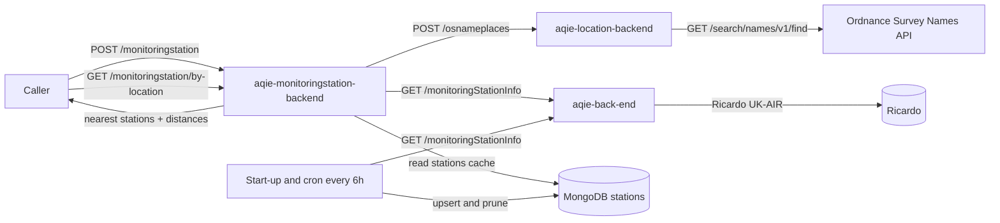

# aqie-monitoringstation-backend

> An aggregator. Given a place name and a search radius it calls `aqie-location-backend` to
> resolve the place to coordinates and `aqie-back-end` for the monitoring station dataset,
> then joins the two to return the nearest stations with their distances and the pollutants
> they measure. It also keeps a cached copy of the station list so a single station can be
> looked up by its coordinates.

## 1. Service Metadata

| Field | Value |
|---|---|
| Repository | [`DEFRA/aqie-monitoringstation-backend`](https://github.com/DEFRA/aqie-monitoringstation-backend) |
| Service domain | `Data` |
| Service type | `Auxilary Backend Service` |
| Lifecycle stage | `Production` |
| Primary language | JavaScript |
| Runtime | Node.js `>=22` (ES modules) |
| Default branch | `main` |
| Created (UTC) | `2025-02-14` |
| Last main commit (UTC) | `2026-11-16T09:56:46Z` |
| Last analysed commit | `ad63bb7f` |
| Last analysed (UTC) | `2026-11-19T00:00:00Z` |
| Activity status | `Active` |

## 2. Purpose and Responsibilities

This service owns **one composite question**: *"which air quality monitoring stations are
within N miles of this place, and what do they measure?"* It holds no authoritative data of
its own. Its entire value is the aggregation. The only thing it stores is a cache of the
Ricardo station list, used by the single-station lookup and nothing else.

**Does:**

- Accepts a place name and a radius in miles on `POST /monitoringstation`.
- **Fan-out step 1:** calls `aqie-location-backend` `POST /osnameplaces` to resolve the place
  name to Ordnance Survey gazetteer matches with coordinates.
- **Fan-out step 2:** calls `aqie-back-end` `GET /monitoringStationInfo` with
  `with-closed=true&with-pollutants=1&stream=data` to retrieve the full station dataset,
  including closed sites and their pollutant metadata.
- Normalises the station payload: maps the verbose upstream pollutant descriptions (which
  arrive with HTML subscript markup) onto short codes such as `PM25`, `GR10U`, `NO2`, `O3` and
  `SO2`, and converts `dd/mm/yyyy` operating dates to ISO form.
- **Join step:** orders stations by geodesic distance from the resolved coordinates using
  `geolib`, takes the 40 nearest, keeps those inside the requested radius, and computes each
  station's distance.
- Filters out stations with no usable pollutants, and drops pollutants whose measurement
  period ended before 2018.
- Applies display-friendly aliases (`PM25` becomes `PM2.5`, `NO2` becomes `Nitrogen dioxide`,
  and so on), sorts the result nearest-first and orders each station's pollutant list into the
  standard PM2.5, PM10, NO2, ozone, sulphur dioxide sequence.
- Reverses the upstream `areaType` wording into the form the front end expects.
- Returns both Ricardo identifiers for every station: `localSiteID` (the short local code) and
  `siteId` (the long form that `aqie-back-end` `GET /monitoringStationHistory` requires), with
  `siteId` null when Ricardo has none.
- **Cache refresh:** at start-up and then on a cron schedule (every six hours by default) it
  fetches the full station list from `aqie-back-end`, upserts it into MongoDB and prunes
  stations Ricardo no longer returns. A shared lock stops two instances refreshing at once.
- **Single-station lookup:** `GET /monitoringstation/by-location` finds one station from the
  cached list by latitude and longitude (falling back to the name when coordinates collide),
  with no live upstream call.

**Does not:**

- Call Ordnance Survey directly. It always goes through `aqie-location-backend`, which owns
  the OS API key. Despite the `/osnameplaces` route name and the `OSPlace_API_URL` variable,
  this service is a client of that API, not a provider of it. The `GET /osnameplaces` route
  it registers is a leftover duplicate of the search handler.
- Call the Ricardo UK-AIR API directly, despite the `RICARDO_API_URL` variable name. That
  variable points at `aqie-back-end`, which is the service that actually talks to Ricardo. The
  naming is a legacy artefact — see Section 11.
- Ingest measurements or serve them. The radius search is answered from live upstream calls
  on every request; only the single-station lookup reads the cache.
- Serve historic time series or extracts — that is `aqie-historicaldata-backend`.
- Calculate DAQI. It passes through what `aqie-back-end` provides.

## 3. Architecture

**Pattern:** Hapi HTTP aggregator with one small scheduled job. A radius search triggers two
outbound calls and an in-memory spatial join, with no cache in the path. Separately, a
cron-driven job keeps a MongoDB copy of the Ricardo station list, which only the
single-station lookup reads.

| Component | Path | Responsibility |
|---|---|---|
| Routes | `src/api/location/index.js` | Registers `GET /osnameplaces`, `POST /monitoringstation` and `GET /monitoringstation/by-location` |
| Controllers | `src/api/location/controllers/location.js` | Search handler (error mapping, response shaping, security headers) and single-station handler |
| Orchestration | `src/api/location/helpers/get-osplace-util.js` | Input validation, miles-to-metres conversion, sequencing the join, returning upstream errors |
| Fan-out | `src/api/location/helpers/fetch-data.js` | The upstream calls: location lookup plus Ricardo for the search, Ricardo alone for the scheduler |
| Normalisation | `src/api/location/helpers/frame-siteinfo-data.js` | Maps upstream pollutant names to codes, normalises dates, carries `siteId` |
| Spatial join | `src/api/location/helpers/get-nearest-location.js` | Distance ordering, 40-station cap, radius filter, pollutant filtering and aliasing |
| Geometry helpers | `src/api/location/helpers/location-util.js` | Coordinate conversion and range tests |
| Station cache | `src/api/location/helpers/stations-repository.js` | `stations` collection: bulk upsert, prune, read all |
| Station lookup | `src/api/location/helpers/find-station-by-coordinates.js`, `to-station-search-result.js` | Coordinate match with name tie-break; shapes a cached station like a search result |
| Scheduler | `src/api/location/ricardo-stations-scheduler.js` | Hapi plugin: start-up sync plus `node-cron` schedule, lock-guarded |
| Sync lock | `src/api/common/helpers/sync-lock.js` | Mutex over the shared `mongo-locks` lock manager |
| Health | `src/api/health/index.js` | Liveness endpoint |
| Config | `src/config/index.js` | `convict` schema |
| Common helpers | `src/api/common/helpers/` | MongoDB (connection, indexes, lock manager), logging, tracing, secure context; also proxy and metrics helpers that nothing calls |

### Failure behaviour

Both upstream calls are made through a `catchFetchError` helper that returns an error instead
of throwing. The search orchestration now returns the first error it sees (the location lookup
is checked before Ricardo), and the controller answers `400` with
`{ message: 'error', error }`. Any exception thrown while joining is caught and answered the
same way. Callers can therefore tell an upstream failure (400) from "no stations near here"
(200 with an empty list) and from blank input (200 with the text `no data found`).

Two caveats. The `400` body carries the raw error text, which for an HTTP error from upstream
includes the internal URL and status. And a `400` is a questionable status for an upstream
outage; by reading the code a place name with no gazetteer match appears to fall into the same
path. The single-station lookup has no upstream call and no error handling: no match is
`404 { message: 'station not found' }` and a MongoDB error is an unhandled 500. See Section 11.

## 4. API Surface

| Method | Path | Purpose | Request | Response |
|---|---|---|---|---|
| `GET` | `/health` | Liveness probe | — | `{ message: 'success' }` |
| `POST` | `/monitoringstation` | Nearest monitoring stations to a place | JSON body with `userLocation` and `usermiles` | `200 { message: 'success', getmonitoringstation }` — stations sorted nearest-first with `region`, `siteType`, `localSiteID`, `siteId`, GeoJSON `location`, `id`, `name`, `updated`, `distance` and an ordered `pollutants` list. Blank input gives `200` with the text `no data found`; an upstream or join failure gives `400 { message: 'error', error }` |
| `GET` | `/monitoringstation/by-location` | One station from the cached list, matched by coordinates | Query `lat`, `lng` and optional `name` (used only to break a tie between co-located stations) | `200 { message: 'success', station }` in the same shape as a search result with `distance` null, or `404 { message: 'station not found' }` |
| `GET` | `/osnameplaces` | Same handler as `POST /monitoringstation`, bound to a `GET` | Reads `request.payload`, so in practice returns the blank-input result | As above |

> `GET /osnameplaces` is a leftover from the first implementation. It shares the
> `POST /monitoringstation` handler and reads its input from the request payload, which a
> `GET` does not carry. Treat `POST /monitoringstation` as the real contract. No other method
> or path is registered. The former `GET /monitoringstation/location={userLocation}` route was
> replaced by the `POST` form in August 2025 (the commit message calls it a pen test fix) and
> its commented-out remains have since been deleted, so any client or test plan still using it
> receives a 404. Trailing slashes are stripped, and every route in `src/api/location/`
> returns the same security headers. Station `location` is declared a GeoJSON point but holds
> latitude first, the reverse of the GeoJSON order. None of the routes has authentication; the
> service relies on its internal CDP address and network position.

## 5. Consumes (Outbound Dependencies)

| Target | Type | Endpoint / Mechanism | Data exchanged | Auth |
|---|---|---|---|---|
| `aqie-location-backend` | `AQIE service` | `POST /osnameplaces` with a JSON body (`OSPlace_API_URL`) | Location string in; gazetteer matches with coordinates out | CDP internal network |
| `aqie-back-end` | `AQIE service` | `GET /monitoringStationInfo?with-closed=true&with-pollutants=1&stream=data` (`RICARDO_API_URL`), called live on every search and by the scheduled cache refresh | Full station metadata including closed sites and pollutant metadata | CDP internal network |
| MongoDB | Datastore | Driver connection (`MONGO_URI`, `MONGO_DATABASE`) | `stations` cache (bulk upsert, prune, read) and `mongo-locks` for the sync lock | `MONGO_URI` |

> `RICARDO_API_URL` defaults to `/monitoringStationInfo` on `aqie-back-end`, and the query
> string is added in code, so every code path targets that endpoint. The `GET /measurements`
> endpoint that `aqie-back-end` removed in
> [PR #163](https://github.com/DEFRA/aqie-back-end/pull/163) survives only as a commented-out
> default in `src/config/index.js`. As at 2026-11-19 `RICARDO_API_URL` is not set in any CDP
> environment, so the default applies everywhere. A stale `MEASUREMENTS_API_URL` that points
> at `/measurements` is still set in all five environments, but the service stopped reading it
> in March 2026. See Section 11.

## 6. Consumed By (Inbound Dependencies)

| Consumer | Endpoint used | Data exchanged |
|---|---|---|
| `aqie-dataselector-frontend` | `POST /monitoringstation` | Location and radius in; nearby stations with pollutants out, used to build the historic data selection |
| `aqie-dataselector-frontend` | `GET /monitoringstation/by-location` | Coordinates and name in; one station out, used when a user arrives from a map deep link at its `/station-summary` page |

> `aqie-maps-frontend` is not a caller, although this repository's README and a code comment
> say so. The map links the user's browser to the dataselector, which then calls this service.
> Performance test plans still use a `GET /monitoringstation/location=` form that no longer
> exists.
>
> Edges are mastered in [`/docs/integration-catalog.yaml`](../../../integration-catalog.yaml).

## 7. Data

- **Store:** MongoDB (`MONGO_DATABASE`, defaulting to `aqie-monitoringstation-backend`),
  with two collections:
  - `stations` — the cached Ricardo station list, indexed on `name` and with a TTL index on
    `syncedAt`. Written only by the scheduler, read only by `GET /monitoringstation/by-location`.
  - `mongo-locks` — the shared lock manager's collection, used for the sync mutex.
  `POST /monitoringstation` neither reads nor writes MongoDB.
- **Key entities:**
  - Gazetteer match — name, district or county, coordinates, from `aqie-location-backend`
    (in flight only).
  - Station — `localSiteID`, `siteId`, name, area and area type, GeoJSON point (latitude
    first), last-updated timestamp, and a pollutant map with start and end dates, from
    `aqie-back-end`. The cached document is this plus a `syncedAt` timestamp, and is upserted
    by station name.
  - Result station — the above plus a computed `distance` (null for a by-location result) and
    a display-ordered pollutant list.
- **Retention / refresh:** the radius search has none: freshness is entirely determined by
  `aqie-back-end` and `aqie-location-backend`. The `stations` cache is refreshed at start-up
  and every six hours by default (`STATIONS_SYNC_SCHEDULE`), stale stations are pruned after a
  non-empty refresh, and the TTL index (`STATIONS_CACHE_TTL_SECONDS`, one week by default)
  removes documents the sync stops touching. If refreshing fails for longer than the TTL the
  whole cache expires. The cache starts empty until the first refresh completes.

## 8. Configuration

Variable names only — values are held in CDP secrets and never recorded here.

| Variable | Purpose |
|---|---|
| `PORT` | HTTP listen port (the Docker image sets 3000; the configuration default is 3002) |
| `NODE_ENV`, `ENVIRONMENT`, `SERVICE_VERSION` | Runtime identity and CDP environment |
| `OSPlace_API_URL` | `aqie-location-backend` `/osnameplaces` endpoint. Set explicitly in every environment, per CDP environment configuration |
| `RICARDO_API_URL` | `aqie-back-end` `/monitoringStationInfo` endpoint, despite the name. The query string is added in code. Not set in any environment per CDP environment configuration, so the default applies |
| `STATIONS_SYNC_SCHEDULE` | Cron expression for the stations cache refresh (default every six hours) |
| `STATIONS_CACHE_TTL_SECONDS` | TTL on cached station documents (default one week) |
| `OSPLACE_API_KEY`, `RICARDO_API_KEY` | Present in the repository only inside commented-out config blocks; not read by the live configuration |
| `MEASUREMENTS_API_URL` | Not read by the code since March 2026. Still set per CDP environment configuration, pointing at the removed `/measurements` endpoint |
| `MONGO_URI`, `MONGO_DATABASE` | MongoDB connection and database name |
| `CDP_HTTP_PROXY`, `CDP_HTTPS_PROXY` | CDP egress proxy. Read only by proxy helpers that nothing calls, so outbound calls do not use it |
| `ACCESS_CONTROL_ALLOW_ORIGIN_URL` | Value of the `Access-Control-Allow-Origin` response header |
| `ENABLE_SECURE_CONTEXT`, `TRUSTSTORE_*` | TLS trust store (every variable starting `TRUSTSTORE_` is loaded) |
| `ENABLE_METRICS` | Read by a metrics helper that nothing calls, so no metrics are emitted |
| `TRACING_HEADER` | Trace header name (default `x-cdp-request-id`) |
| `LOG_ENABLED`, `LOG_LEVEL`, `LOG_FORMAT` | Logging |

`config.validate({ allowed: 'strict' })` rejects undeclared configuration properties, but
stray environment variables such as the orphaned `MEASUREMENTS_API_URL` are ignored. Both
upstream URL defaults interpolate `process.env.ENVIRONMENT` into the CDP internal hostname, so
an unset `ENVIRONMENT` produces an unroutable default.

## 9. Hosting and Deployment

- **Platform:** DEFRA Core Delivery Platform (CDP) on AWS ECS.
- **Container:** multi-stage build from `defradigital/node-development` to `defradigital/node`
  (both `latest-22`); image port 3000; entrypoint `node .`.
- **Internal address:** `https://aqie-monitoringstation-backend.<env>.cdp-int.defra.cloud`.
- **Environments:** CDP `dev`, `test`, `perf-test` and `prod`. The stations refresh job takes
  a shared lock, so only one instance refreshes the cache at a time. A separate
  `aqie-monitorstation-perf-backend` repository exists for performance testing and is archived.
- **Local development:** `compose.yml` provides MongoDB, Redis and LocalStack on remapped host
  ports, and the service container also reads a git-ignored `.env`. Only MongoDB is used by
  the application.
- **Pipelines:**
  - `.github/workflows/build.yml` — SonarQube scan on push to `main`
  - `.github/workflows/check-pull-request.yml` — format check, lint, tests, a Docker build
    test and a Sonar scan on PR
  - `.github/workflows/publish.yml` — build, test, Sonar scan and publish on push to `main`
  - `.github/workflows/publish-hotfix.yml` — manual hotfix publish

## 10. Observability

- **Logging:** `pino` via `hapi-pino`, formatted with `@elastic/ecs-pino-format` in production;
  `/health` requests are not logged. Upstream failures are logged at `error` level with the
  fetch error message, and each refresh logs the station count and number pruned. The user's
  place name and radius are logged at `info` level.
- **Tracing:** `@defra/hapi-tracing` reads the header named in `TRACING_HEADER` and adds the
  trace id to log lines. Outbound calls do not forward it.
- **Metrics:** a CloudWatch EMF helper (`aws-embedded-metrics`) exists, gated by
  `ENABLE_METRICS`, but nothing calls it, so no metrics are emitted.
- **Shutdown:** `hapi-pulse` for graceful draining; the Mongo client is closed and the cron
  task stopped when the server stops.

## 11. Open Questions

- [ ] `RICARDO_API_URL` points at `aqie-back-end`, not Ricardo. Confirm this can be renamed —
      the current name misleads anyone reading the configuration or the CDP environment.
- [ ] (catalogue `oq-014`) `MEASUREMENTS_API_URL` is still set to the removed `/measurements` endpoint in the CDP
      environments (per CDP environment configuration), although the service stopped reading
      it in March 2026. Confirm it can
      be deleted from the CDP configuration, and delete the commented-out `/measurements`
      default in `src/config/index.js` so neither can be reinstated by mistake.
- [ ] (catalogue `oq-009`) The `perf-test` value of `OSPlace_API_URL` still uses the retired
      GET-style path form that `aqie-location-backend` no longer serves (per CDP environment
      configuration), so searches there are expected to fail (read, not run). Confirm the
      correct value, and update the performance test plans, which still call
      `GET /monitoringstation/location=` and `GET /osnameplaces/userLocation=`.
- [ ] (catalogue `oq-028`) Upstream failures now return `400`. Confirm that is the intended status for an upstream
      outage. The dataselector's search page treats any failure as "no stations" while its
      location page shows a 500, and a place name with no match appears to return the same
      `400` with an internal error message rather than an empty result.
- [ ] `GET /monitoringstation/by-location` has no route validation or error handling and reads
      the whole `stations` collection on each request. Confirm the intended callers: the
      README names `aqie-maps-frontend`, which does not call it.
- [ ] The `stations` cache starts empty and expires entirely if refreshing fails for longer
      than the TTL, and the by-location lookup then returns `404`. Confirm that is acceptable,
      and whether Ricardo station names are unique, because the cache is upserted by name.
- [ ] `GET /osnameplaces` reads a request payload that a `GET` does not carry. Confirm it can
      be removed.
- [ ] The 2018 cut-off on pollutant end dates is hardcoded in two places. Confirm the policy
      basis and whether it should be configurable.
- [ ] Neither this service nor `aqie-back-end` pages through Ricardo's station list. Confirm
      that `/monitoringStationInfo?stream=data` returns every station in one response, since
      the search and the cache both assume it does.
- [ ] Station `location` is a GeoJSON point holding latitude first. Confirm every consumer
      relies on that order.
- [ ] Redis and LocalStack are provisioned in `compose.yml` but unused by the application, and
      several dependencies and helpers are never used (`aws4`, `lodash`, `@hapi/boom`,
      `node-fetch`, the proxy and metrics helpers). Confirm they can be removed.
- [ ] `publish.yml` still uses the floating `SonarSource/sonarcloud-github-action@master`
      reference, whereas the other two workflows pin the scan action to a commit.
