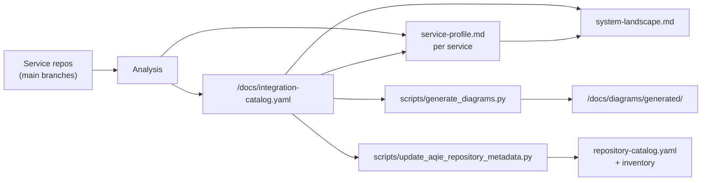

# Dynamic Update Workflow

## Principle

The integration catalogue is the source of truth. Repository metadata, diagrams and
`connected_services` are all derived from it or from the GitHub API. Prose is written last.



## End-to-end process

Precondition: `DEFRA_READONLY_PAT` is configured, or `gh` is authenticated locally.

1. **Refresh metadata** — run `update_aqie_repository_metadata.py`. New repositories are
   discovered automatically via the GitHub search API. The script reads each repository's
   `Last analysed commit` and `Last analysed (UTC)` from the metadata table in its service
   profile and carries them into the repository catalogue, so a refresh never resets them.
2. **Find deltas** — the same run prints the repositories whose default-branch HEAD differs
   from the analysed commit, and the repositories that have no profile yet. Those two lists
   are the work for this cycle. Pin each repository's HEAD SHA at this point and analyse
   exactly that commit, so a repository that moves mid-cycle does not change the analysis.
   Repositories with no new commits need no analysis, but their derived fields still change
   with time: recompute `Activity status` for every profile against the cycle date, and
   check each repository's archived and visibility state.
3. **Analyse changed repositories** — clone outside the workspace and establish routes,
   outbound calls, environment variable names, data stores, hosting and structure. Read the
   source; never install, build, boot or run it (see below).
4. **Update the integration catalogue** — add, amend or refute edges with evidence.
5. **Update service profiles** for changed repositories, and create profiles for new ones.
6. **Update domain overviews and the system landscape.**
7. **Regenerate diagrams** — run `generate_diagrams.py`.
8. **Update the draw.io poster** if the structural picture changed materially.
9. **Record the run** in the audit log, and any new findings in the security findings file.

## Main-branch delta rule

- Analyse `main` only.
- Ignore feature branches, draft work and unmerged pull requests.
- Analysis window per repository:
  - Start: `last_analysed_main_commit`, or the initial baseline if null
  - End: current `origin/main` HEAD

## Evidence sources

- **Public source first.** Everything in this repository should be traceable to the public
  `main` branch of a service repository.
- **Read, never run.** Do not install dependencies, build, boot or test the code being
  analysed, and do not execute anything from it. Running third-party code on the analysis
  machine is a supply-chain risk. Routes, configuration and call sites can all be
  established by reading.
- **Private deployment configuration** (for example the CDP application configuration
  repository) may be read, read-only, only to settle an existing open question that depends on
  deployed values. Record variable names and yes/no or set/unset facts only. Never record
  values, hostnames that are not already public, account identifiers, or deployment topology
  such as release numbers, instance counts or sizing. Tag every statement taken from such a
  source with the exact phrase `per CDP environment configuration`, so the whole set can be
  found with one search and reviewed before publication. If in doubt, leave it out and raise
  an open question.
- **Discovery limits.** Discovery uses the name filter `aqie in:name`. Related repositories
  with other names are not found automatically (see `oq-033`), so check the GitHub
  organisation for new repositories in the same product areas when planning a cycle.

## Running a cycle with several analysts

A cycle across many repositories can be split by repository. Give each analyst the pinned
commits, the rules in
[`/docs/agent-instructions/dynamic-update-instructions.md`](../agent-instructions/dynamic-update-instructions.md)
and ownership of only its own service profiles. Each writes a short report (catalogue changes
as ready-to-paste entries, findings, open questions and wider impacts) to a scratch folder
outside this repository, and saves it early, because a long run can be interrupted. One
coordinator then merges the catalogue, overviews, landscape, findings, diagrams and audit log
in a single pass, so shared files have one editor.

## Commands

```bash
GITHUB_TOKEN=$(gh auth token) python3 scripts/update_aqie_repository_metadata.py
python3 scripts/generate_diagrams.py
```

Both require `PyYAML`.

## Completion criteria

- All changed repositories have refreshed profiles, and new repositories have profiles
- `Activity status` recomputed for every profile, including unchanged ones
- Integration catalogue reflects reality, including disproved edges under `refuted_edges`
- Generated diagrams regenerated and committed
- System landscape aligned with per-service changes
- Audit log updated
- New security or information governance findings recorded
- A search for `per CDP environment configuration` has been reviewed, and nothing derived from
  a private source records a value, a non-public hostname or deployment topology

## What not to do

- Do not hand-edit anything under `/docs/diagrams/generated/`.
- Do not infer `connected_services` from repository names.
- Do not record secret values, only variable names.
- Do not treat a configuration key as an integration without confirming a call site exists.
- Do not install or run code from the repositories being analysed.
